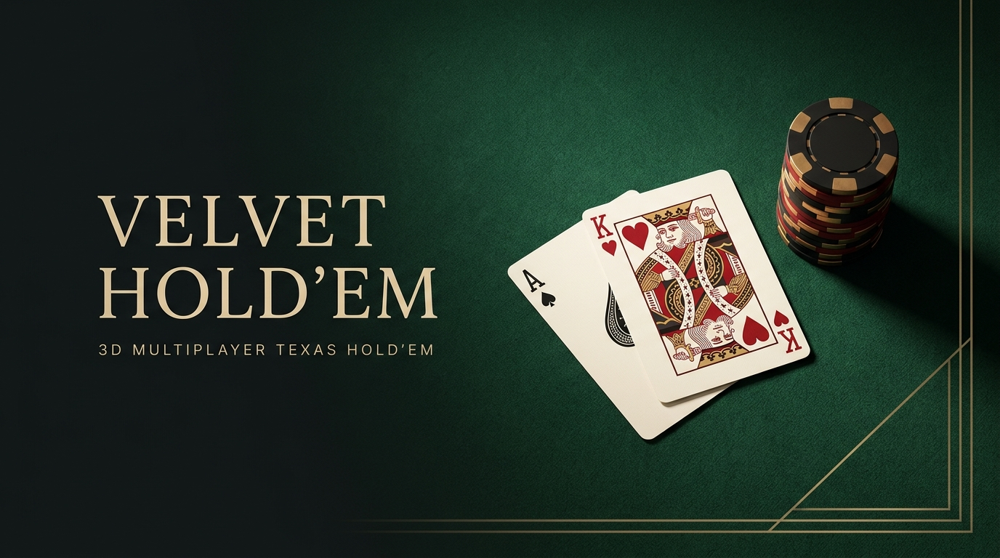
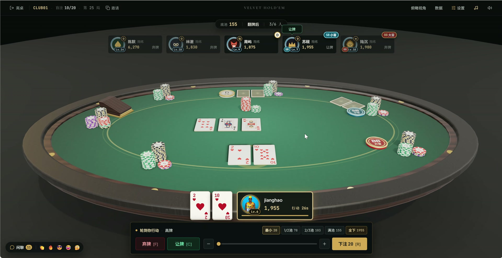
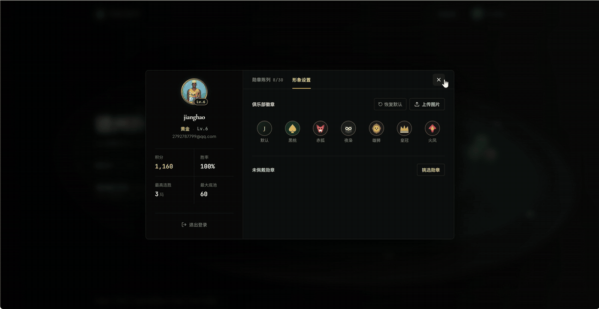
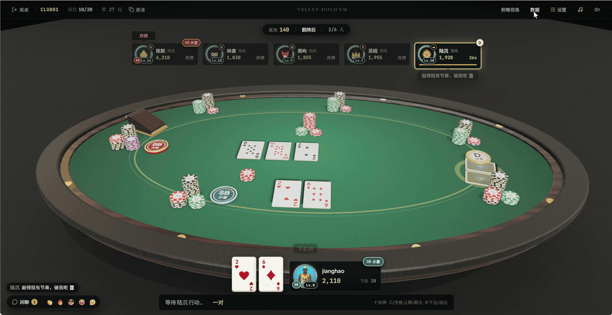
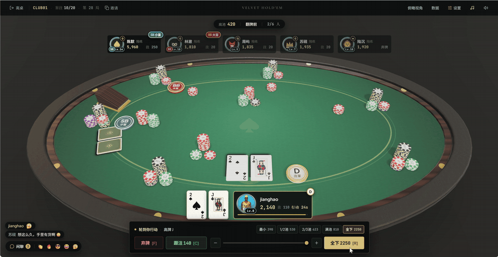
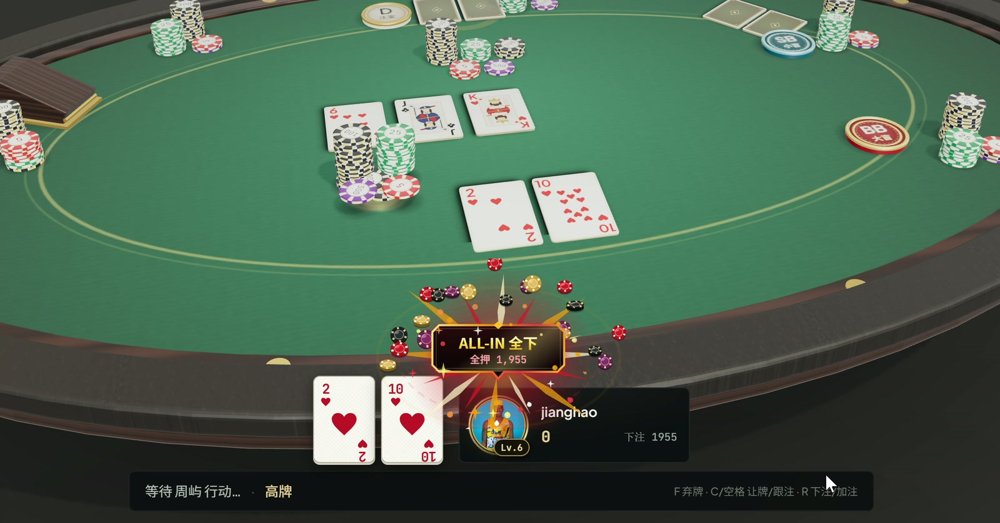
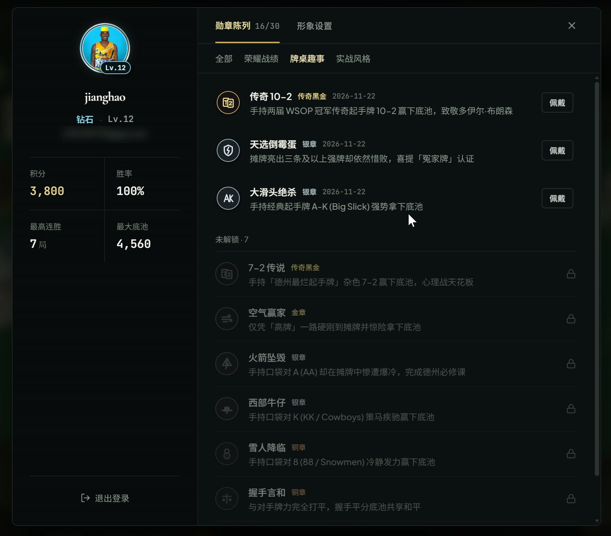
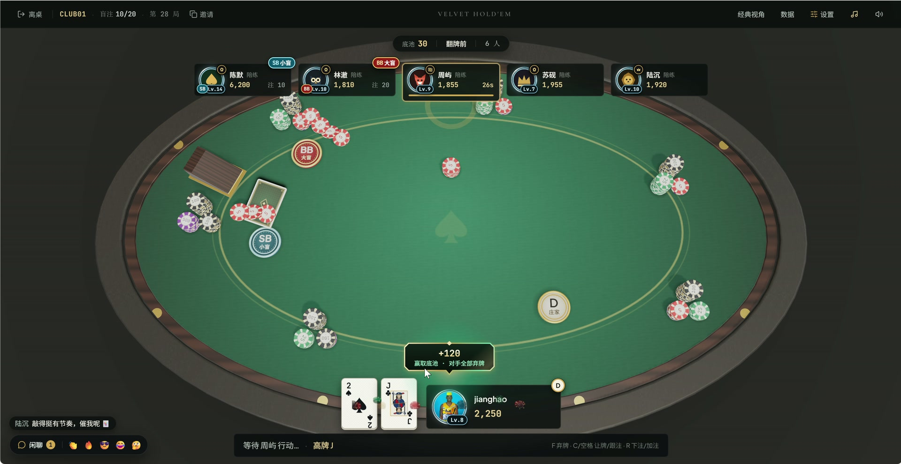
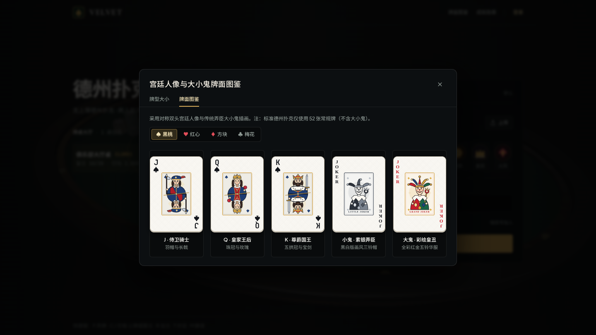
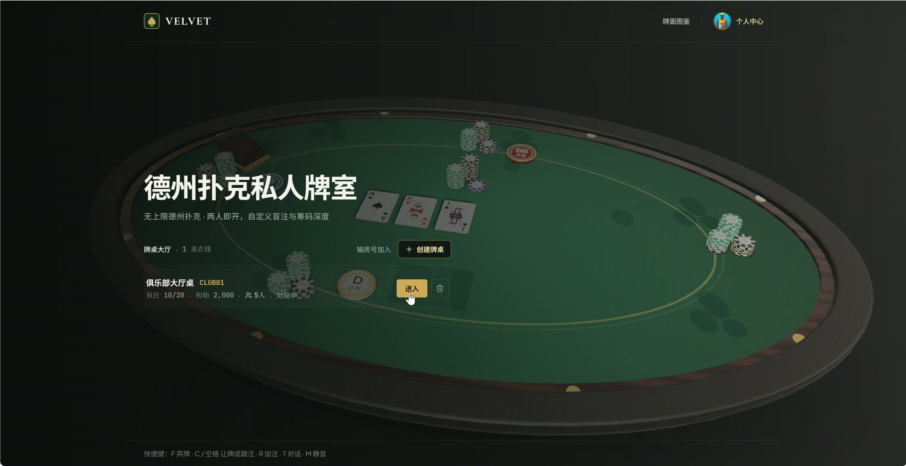

<p align="center">
  <a href="#promo-reel">
    
  </a>
</p>

<div align="center">

<p>
  <a href="README.md">简体中文</a> &nbsp;|&nbsp; <strong>English</strong>
</p>

<h3>The Quiet Tactility of a Private Poker Salon, Built for the Browser</h3>

<p>
  <a href="#promo-reel">Promo</a> &nbsp;&nbsp;·&nbsp;&nbsp;
  <a href="#gameplay-flow">Gameplay Flow</a> &nbsp;&nbsp;·&nbsp;&nbsp;
  <a href="#design--highlights">Highlights</a> &nbsp;&nbsp;·&nbsp;&nbsp;
  <a href="#gto--safe-exploitation-engine">GTO & Exploitation</a> &nbsp;&nbsp;·&nbsp;&nbsp;
  <a href="#architecture">Architecture</a> &nbsp;&nbsp;·&nbsp;&nbsp;
  <a href="#quick-start">Quick Start</a> &nbsp;&nbsp;·&nbsp;&nbsp;
  <a href="#compliance">Compliance</a>
</p>

<p>
  
  
  
  
  
  
  
</p>

<br />

<p>
  A real-time 3D multiplayer No-Limit Texas Hold'em web application crafted for private friend games and serious GTO practice.<br />
  No loud arcade popups and no cut-corner rules — engineered around <strong>instant seating, rigorous WSOP/TDA accounting, and research-backed poker AI</strong>.
</p>

</div>

<br />

## Promo Reel

<p align="center">
  
  <br />
  <sub>
    65-second live gameplay promo (inline animated WebP) · Watch or download the 1080p edition with jazz BGM & synthesized chip physics audio:
    <a href="https://github.com/jianghao-jianghao-jianghao/newHoldem/raw/main/docs/media/promo.mp4"><strong>Direct MP4 Video</strong></a>
  </sub>
</p>

<br />

<table>
  <tr>
    <td width="25%" valign="top">
      <strong>3D Velvet Salon</strong><br />
      <sub>Three.js emerald felt table, walnut rail, physical chip stacks, dual camera angles, and seamless 2D fallback when WebGL is unavailable.</sub>
    </td>
    <td width="25%" valign="top">
      <strong>GTO v3 × Safe Exploitation</strong><br />
      <sub>WSOP/TDA multi-way side pots & Rule 47, 169-hand preflop matrices, Bayesian opponent profiling, and Restricted Nash Response (RNR) counters.</sub>
    </td>
    <td width="25%" valign="top">
      <strong>GTO Workbench & AI Radar</strong><br />
      <sub>Interactive 13×13 strategy matrix, 5-tier EV Loss grading, Bayesian Node-Lock lab, and 6-axis player persona radar (Gemini / DeepSeek).</sub>
    </td>
    <td width="25%" valign="top">
      <strong>Zero-Friction & Persistent</strong><br />
      <sub>Play and host rooms as a guest with zero login; optional 6-digit email OTP syncs persistent SQLite (WAL) profiles. Docker Compose ready.</sub>
    </td>
  </tr>
</table>

<p align="center">
  
  <br />
  <sub>Desktop 3D WebGL felt table · Automatic responsive 2D fallback on mobile or software renderers</sub>
</p>

<p align="center"></p>

## Gameplay Flow

Six live captures showing the complete rhythm of a table — from lobby seating to camera angles, all-in impacts, multi-way showdown, chat, and GTO hand review:

<table>
  <tr>
    <td width="33.3%" align="center" valign="top">
      <br />
      <strong>01 · Instant Seating</strong><br />
      <sub>Browse live rooms or host a custom table without login</sub>
    </td>
    <td width="33.3%" align="center" valign="top">
      <br />
      <strong>02 · Dual Camera Views</strong><br />
      <sub>Smooth transition between classic 45° and 90° top-down</sub>
    </td>
    <td width="33.3%" align="center" valign="top">
      <br />
      <strong>03 · All-In Impact</strong><br />
      <sub>Canvas shockwaves, chip fountains, and medal unlocks</sub>
    </td>
  </tr>
  <tr>
    <td width="33.3%" align="center" valign="top">
      <br />
      <strong>04 · Showdown & Side Pots</strong><br />
      <sub>Stepped all-in runouts and exact multi-tier side pots</sub>
    </td>
    <td width="33.3%" align="center" valign="top">
      <br />
      <strong>05 · Salon Chat & Bots</strong><br />
      <sub>Unified reactions and optional LLM-powered bot banter</sub>
    </td>
    <td width="33.3%" align="center" valign="top">
      <br />
      <strong>06 · GTO Workbench</strong><br />
      <sub>13×13 strategy matrix, Node-Lock lab, and hand replays</sub>
    </td>
  </tr>
</table>

<p align="center"></p>

## Design & Highlights

<table>
  <tr>
    <td width="58%" align="center" valign="middle">
      
    </td>
    <td width="42%" valign="middle">
      <h4>Restrained Salon Aesthetics × Physical Audio</h4>
      <p>Low-saturation emerald felt, walnut trim, brass studs, bespoke symmetrical <code>J / Q / K</code> court cards, and crisp <code>D / SB / BB</code> markers built for long sessions.</p>
      <p>All-in pushes and pot wins render real-time Canvas 2D shockwaves and multi-denomination chip fountains; every bet synthesizes denomination-aware physical chip audio (<code>5 / 25 / 100 / 500 / 1000+</code>) alongside toggleable lounge jazz BGM (<kbd>M</kbd>).</p>
    </td>
  </tr>
  <tr>
    <td width="42%" valign="middle">
      <h4>WSOP/TDA Rules × GTO v3 & Hand Review Workbench</h4>
      <p>Supports 2–10 seat tables, cryptographically secure shuffling (<code>crypto.randomInt</code>), multi-tier side pots, uncalled bet refunds, dead-money conservation on mid-hand departure, WSOP Rule 47 short all-in re-open checks, and between-hand rebuys.</p>
      <p>Includes a live <strong>GTO v3 + RNR</strong> practice bot engine and an interactive <strong>13×13 GTO & Node-Lock Workbench</strong> with 5-tier EV Loss grading, range/nut advantage metrics, blocker removal analysis, and optional Gemini / DeepSeek coaching.</p>
    </td>
    <td width="58%" align="center" valign="middle">
      
    </td>
  </tr>
  <tr>
    <td width="58%" align="center" valign="middle">
      
    </td>
    <td width="42%" valign="middle">
      <h4>30 Achievements × 6-Axis Persona Radar × Guest Play</h4>
      <p>Jump straight into any table or create a private room without signing up. Sign in anytime via <strong>6-digit email OTP</strong> (SMTP / Resend) to unlock cross-device personal analytics, 6-axis playstyle radar (VPIP / PFR / Agg% / C-Bet / Showdown / Discipline), and automatic merging of guest achievements.</p>
      <p>Track <strong>30</strong> Bronze / Silver / Gold / Obsidian achievements with dynamic Bronze-to-Diamond rank auras rendered live around seat avatars.</p>
    </td>
  </tr>
</table>

<br />

<p align="center">
  
  <br />
  <sub>Session Ledger & Review · Standings · Chip Curves · Street Pot Growth · 6-Axis Persona Radar · 13×13 GTO Strategy Matrix & Node-Lock Lab</sub>
</p>

<table>
  <tr>
    <td width="50%" align="center">
      <br />
      <sub>Top-down overview · 3D chip stacks & blind positions</sub>
    </td>
    <td width="50%" align="center">
      <br />
      <sub>Original symmetrical court portraits & hand rankings reference</sub>
    </td>
  </tr>
  <tr>
    <td width="50%" align="center">
      <br />
      <sub>Minimal salon chat with unified emoji & quick phrases</sub>
    </td>
    <td width="50%" align="center">
      <br />
      <sub>3D poker lobby · Custom blinds, stack depth & room codes</sub>
    </td>
  </tr>
</table>

<p align="center"></p>

## GTO & Safe Exploitation Engine

Inspired by open-source poker solvers and imperfect-information game theory research (`bupticybee/TexasSolver` DCFR, Johanson et al. NIPS 2007 *Restricted Nash Response*, Bard et al. 2013 *Data-Biased Robust Counter Strategies*, *Pluribus* depth-limited subgame solving, and *PokerBench* structured reasoning — full math spec in [docs/GTO_EXPLOIT_ARCHITECTURE_SPEC.md](docs/GTO_EXPLOIT_ARCHITECTURE_SPEC.md)):

| Layer | Core Mechanics | Modules |
| :--- | :--- | :--- |
| **GTO v3 Equilibrium Baseline** | 6-max / HU 169-hand preflop matrices, ≤15BB Nash push/fold, zero-allocation O(1) 7-card evaluator, aggression-weighted Monte Carlo equity, board range/nut advantage estimation, turn scare-card double barrels, polarized river overbets, MDF, blocker removal, and geometric bet sizing | [server/gtoRanges.ts](server/gtoRanges.ts)<br>[server/botAi.ts](server/botAi.ts) |
| **Bayesian Opponent & Player Profiling** | Beta-Binomial prior shrinkage $\hat{\theta}_{\text{post}} = \frac{\kappa \pi_{\text{GTO}} + c}{\kappa + n}$ across VPIP, PFR, Limp, 3-Bet, Fold-to-3Bet, C-Bet, Fold-to-CBet, Fold-to-Bet, WTSD, W$SD, and Turn Barrel; classifies 7 live archetypes + concrete leak tags with optional low-weight historical prior warm-start | [server/opponentProfiler.ts](server/opponentProfiler.ts)<br>[src/shared/playerInsights.ts](src/shared/playerInsights.ts) |
| **RNR Safe Exploitation & Node-Lock** | Restricted Nash Response safety blend $\sigma_{\text{RNR}} = (1 - \lambda w)\sigma_{\text{GTO}} + \lambda w\,\sigma_{\text{BR}}(\hat{\theta}_{\text{post}})$ stays close to equilibrium on small samples and targets confirmed leaks (over-folders, calling stations, maniacs, c-bet spammers, limp-passives) as evidence grows; 3-tier server solver adds suit-isomorphism canonicalization (22,100 → 1,755 flops), LRU caching, and an optional `TexasSolver` worker pool | [server/gtoSolver.ts](server/gtoSolver.ts)<br>[src/shared/gtoWorkbench.ts](src/shared/gtoWorkbench.ts) |
| **AI Enhancement & Dual-Provider Coaching** | Optional `AI_BOT_ENHANCEMENT` invokes a strict 1.8s-budget DeepSeek tactical overlay on high-leverage postflop pots with legal-action & nuts-protection guardrails; `/api/persona/analyze` supports Google Gemini with automatic DeepSeek fallback; `/api/gto/evaluate` combines GTO math with live room opponent reads | [server/botAiAdvisor.ts](server/botAiAdvisor.ts)<br>[server/personaAi.ts](server/personaAi.ts)<br>[server/gtoCoach.ts](server/gtoCoach.ts) |

<p align="center"></p>

## Architecture

<p align="center">
  <picture>
    <source media="(prefers-color-scheme: dark)" srcset="docs/media/architecture-dark.svg" />
    <source media="(prefers-color-scheme: light)" srcset="docs/media/architecture-light.svg" />
    
  </picture>
</p>

<details>
<summary>Project Structure & Contracts</summary>

```text
.
├── server.ts                  # Express + WebSocket server, room lifecycle, rate limits & security
├── server/
│   ├── db.ts                  # Node 22 native SQLite (WAL) schema, migrations & hand_history
│   ├── authStore.ts           # Pure email 6-digit OTP auth, SMTP/Resend delivery & token revocation
│   ├── roomAuth.ts            # Constant-time X-Seat-Secret verification & room deletion auth
│   ├── leaderboard.ts         # Persistent leaderboard, bot-practice normalization & behavior stats
│   ├── rateLimiter.ts         # Sliding-window rate limiters (HTTP / OTP / GTO / Persona / WS)
│   ├── gtoRanges.ts           # 6-max / HU 169-hand matrices, Nash push/fold & O(1) evaluator
│   ├── botAi.ts               # GTO v3 + Range/Nut advantage + RNR exploitative bot engine
│   ├── botAiAdvisor.ts        # Optional LLM tactical advisor with safety guardrails & fallback
│   ├── opponentProfiler.ts    # Bayesian Dirichlet-Beta profiler & RNR exploit planner
│   ├── gtoSolver.ts           # 3-tier GTO solver, suit-isomorphism LRU cache & Node-Lock service
│   ├── gtoCoach.ts            # GTO + live opponent-read coaching endpoint
│   ├── handReview.ts          # Street-by-street evidence & hand review generator
│   ├── personaAi.ts           # Dual-provider (Gemini / DeepSeek) 6-axis persona analyzer
│   └── botChat.ts             # Table bot banter builder with hole-card redaction
├── src/
│   ├── shared/                # Shared poker engine, hand evaluator, GTO workbench & insights
│   ├── context/               # Email OTP auth context & profile sync
│   ├── components/            # Lobby, 3D/2D table, HandReviewModal, 13×13 Matrix, Persona Radar
│   ├── three/                 # Three.js table, chip physics & camera transitions
│   └── utils/                 # Synthesized chip audio, lounge BGM & Canvas impact FX
├── docs/
│   ├── ARCHITECTURE.md                   # System architecture reference (English, agent-friendly)
│   ├── DEVELOPER_GUIDE.md                # Developer handbook & CPU-only workflows (English)
│   ├── GTO_EXPLOIT_ARCHITECTURE_SPEC.md  # GTO & Bayesian Node-Lock math reference
│   └── media/
├── deploy/nginx.conf.example  # Production Nginx HTTPS + WSS reverse proxy template
├── Dockerfile                 # Multi-stage node:22-slim non-root container image
├── docker-compose.yml         # Single-command deployment with ./data SQLite volume
└── UI_CONTRACT.md             # Frontend-backend REST & WebSocket contract
```

</details>

<p align="center"></p>

## Quick Start

<table>
  <tr>
    <td width="50%" valign="top">
      <strong>Docker Compose (Recommended)</strong><br />
      <sub>Multi-stage <code>node:22-slim</code> non-root image with <code>./data</code> SQLite volume</sub>
      <pre lang="bash">git clone https://github.com/jianghao-jianghao-jianghao/newHoldem.git
cd newHoldem
cp .env.example .env
docker compose up -d --build</pre>
    </td>
    <td width="50%" valign="top">
      <strong>Local Development (Node.js &gt;= 22.5)</strong><br />
      <sub>Zero-config startup with multiplayer WS, native SQLite & GTO v3 bots</sub>
      <pre lang="bash">git clone https://github.com/jianghao-jianghao-jianghao/newHoldem.git
cd newHoldem
npm install
npm run dev</pre>
    </td>
  </tr>
</table>

Open `http://localhost:3000` (health check: `GET /api/health`). For public HTTPS / WSS deployment, see [deploy/nginx.conf.example](deploy/nginx.conf.example) and set `TRUST_PROXY=1` plus a strong random `AUTH_SESSION_SECRET` in `.env`.

> **Windows + WSL2 Docker tip**: Add `vmIdleTimeout=-1` under `[wsl2]` in `C:\Users\<username>\.wslconfig` (or keep a WSL terminal open) so WSL2 does not auto-suspend idle Docker ports.

<br />

**Keyboard Shortcuts & Gestures** (automatically paused while typing or inside modals):

<p>
  <kbd>F</kbd> Fold &nbsp;·&nbsp;
  <kbd>C</kbd> / <kbd>Space</kbd> Check or Call &nbsp;·&nbsp;
  <kbd>R</kbd> Bet / Raise &nbsp;·&nbsp;
  <kbd>T</kbd> Toggle Chat &nbsp;·&nbsp;
  <kbd>M</kbd> Mute Audio & BGM &nbsp;·&nbsp;
  <kbd>Esc</kbd> Close Modal &nbsp;·&nbsp;
  <strong>Click Avatar</strong> Inspect Profile & Medals &nbsp;·&nbsp;
  <strong>Double-Click Opponent</strong> Table Nudge
</p>

<details>
<summary>Environment Variables, Test Commands & Core APIs</summary>

<br />

Copy `.env.example` to `.env` as needed (every external API key is optional):

| Variable | Default | Purpose |
| :--- | :--- | :--- |
| `PORT` | `3000` | Single-port server serving static frontend, REST APIs, and `/ws` |
| `DATA_DIR` | `./data` | Directory for SQLite database & session key (mounted to `/app/data` in Docker) |
| `AUTH_SESSION_SECRET` | Auto-generated | HMAC signing secret for login tokens (use ≥32-char random hex in production) |
| `ALLOW_OTP_PREVIEW` | `false` | Set `true` only for local dev without email delivery; keep `false` in production |
| `SMTP_*` / `RESEND_API_KEY` | — | Email OTP delivery (Resend takes priority over SMTP; supports QQ Mail port `465`) |
| `DEEPSEEK_API_KEY` / `DEEPSEEK_MODEL` | `deepseek-chat` | Optional DeepSeek config for bot chat, GTO Coach, and Persona Radar fallback |
| `GEMINI_API_KEY` / `GEMINI_MODEL` | — | Optional Google Gemini config for server-side 6-axis persona radar analysis |
| `TEXASSOLVER_BIN` | Empty | Optional Layer-3 `console_solver` binary path (falls back to Layer 1/2 if unset) |
| `AI_BOT_ENHANCEMENT` | `false` | Enables 1.8s-budget DeepSeek tactical overlay on high-leverage postflop bot pots |
| `TRUST_PROXY` / `CORS_ORIGIN` | `0` / `*` | Reverse proxy hop count (`1` behind Nginx) and allowed CORS origins |
| `VITE_SERVER_URL` | Empty | External API/WS base URL when frontend & backend are hosted on different origins |

```bash
npm run lint    # TypeScript type checking
npm test        # 22 test suites, 129 unit tests (CPU-only, <2s)
npm run build   # Production Vite client + esbuild server bundle
npm start       # Run production server
```

| Endpoint | Description |
| :--- | :--- |
| `GET /api/health` · `GET /api/metrics` | Health probe (`botEngine: "gto-v3-rnr"`), SQLite ping, solver cache stats & bot latency |
| `GET / POST / DELETE /api/rooms` | List rooms, create custom tables without login, delete rooms via `X-Player-Id` + `X-Seat-Secret` |
| `GET /api/rooms/:roomId/opponent-profiles` | Live Bayesian opponent reads, leak tags & RNR exploit plans (zero hole-card leakage) |
| `POST /api/rooms/:roomId/hand-review` · `session-review` | Street-by-street evidence & session review reports |
| `POST /api/gto/spot-analysis` · `node-lock` · `session-audit` | 3-tier 13×13 GTO solver, Bayesian Node-Lock exploitation & session EV leak audit |
| `POST /api/gto/evaluate` | Stateless GTO + live opponent-read coaching endpoint (optional `useLlm: true`) |
| `POST /api/persona/analyze` | 6-axis player persona radar & coaching (Google Gemini / DeepSeek dual-provider) |
| `POST /api/auth/send-code` · `verify-code` · `logout` | Pure 6-digit email OTP login (merges guest achievements) & server-side token revocation |
| `GET /api/hands` · `WS /ws` | Redacted SQLite hand replay history & real-time multiplayer WebSocket protocol |

</details>

<p align="center"></p>

## Compliance

This project is strictly built for software engineering education and free casual play among friends:

- **Virtual Points Only**: All chips, blinds, pots, PnL curves, and leaderboards represent valueless practice points with zero monetary or redeemable value.
- **No Real-Money Flows**: Contains no deposits, withdrawals, rake, or payment rails. Do not use this codebase for real-money gambling or any unlawful activity.
- **Deployer Responsibility**: Provided "AS IS" under the MIT License; any third-party deployment or modification is solely responsible for local legal compliance.
- **API Key Privacy**: External LLM and email providers are strictly optional; room-scoped keys entered in the UI live in volatile room memory only and are purged on room close.

<br />

<div align="center">
  <sub>Released under the <a href="LICENSE">MIT License</a> · Velvet Hold'em</sub>
</div>
