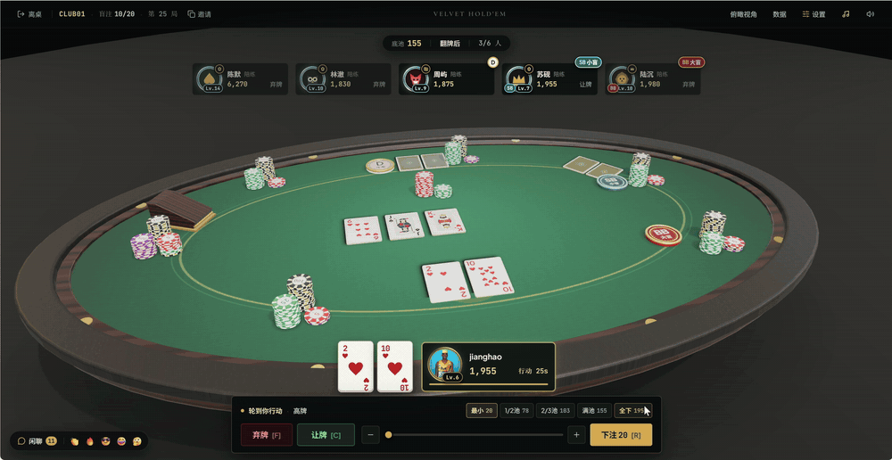
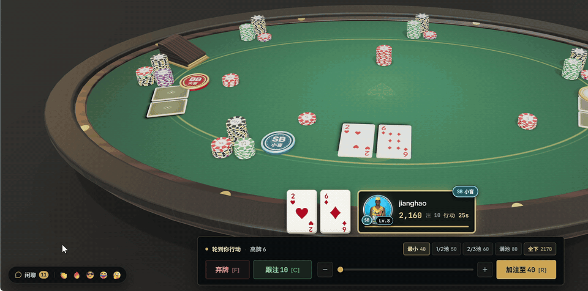
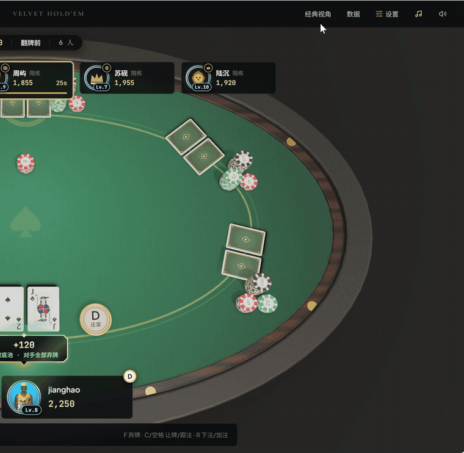
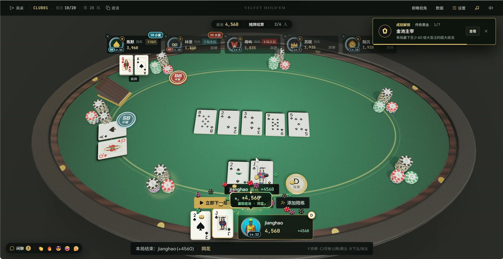
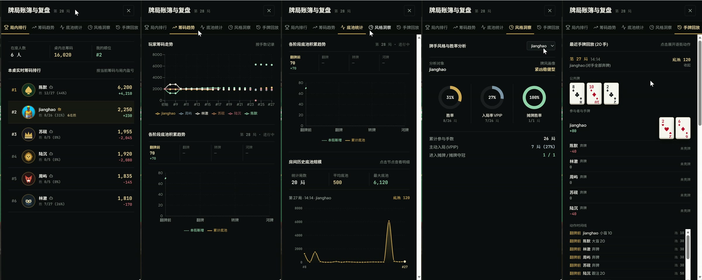
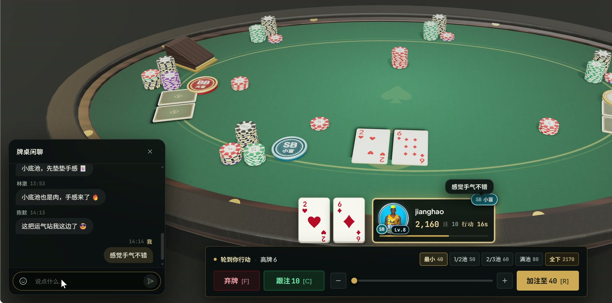
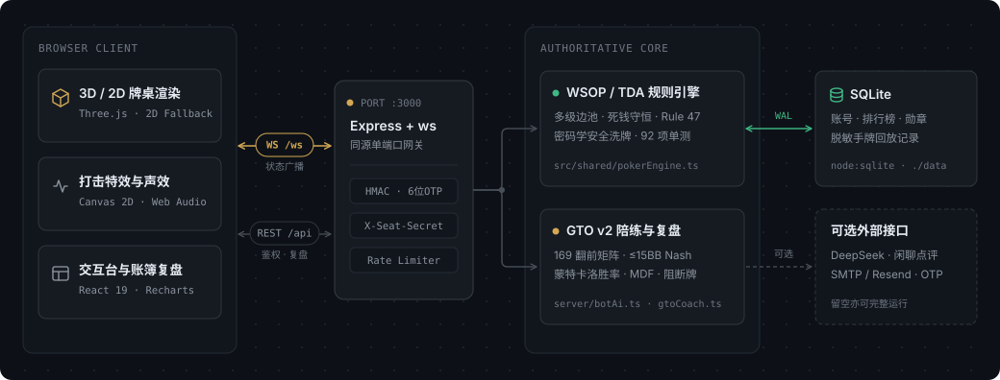

  

  <a href="README.md">简体中文</a> &nbsp;|&nbsp; <strong>English</strong>

<h3>The Quiet Tactility of a Private Poker Salon, Built for the Browser</h3>

  <a href="#promo-reel">Promo</a> &nbsp;&nbsp;·&nbsp;&nbsp;
  <a href="#gameplay-flow">Gameplay Flow</a> &nbsp;&nbsp;·&nbsp;&nbsp;
  <a href="#highlights">Highlights</a> &nbsp;&nbsp;·&nbsp;&nbsp;
  <a href="#strategy--learning-philosophy">Philosophy</a> &nbsp;&nbsp;·&nbsp;&nbsp;
  <a href="#quick-start">Quick Start</a> &nbsp;&nbsp;·&nbsp;&nbsp;
  <a href="#compliance">Compliance</a>

  
  
  
  
  

 

  A real-time 3D multiplayer No-Limit Texas Hold'em web experience built for private friend games and practical poker improvement. 
  No noisy casino popups and no simplified shortcuts — designed around <strong>instant seating, calm visual focus, and actionable hand review</strong>.

 

## Promo Reel

  
   
  
    65-second live gameplay promo (inline animated WebP) · Watch or download the 1080p edition with lounge jazz BGM & chip acoustics:
    <a href="https://github.com/jianghao-jianghao-jianghao/newHoldem/raw/main/docs/media/promo.mp4"><strong>Direct MP4 Video</strong></a>
  

 

<table>
  <tr>
    <td width="25%" valign="top">
      <strong>Restrained 3D Salon</strong> 
      Emerald felt, walnut trim, 3D chip stacks, and smooth dual camera views with automatic 2D fallback on mobile or low-power devices.
    </td>
    <td width="25%" valign="top">
      <strong>Rigorous Rules & Adaptive Bots</strong> 
      Full WSOP/TDA multi-way side pots and Rule 47 paired with bots that start from GTO balance and safely adapt to live table leaks.
    </td>
    <td width="25%" valign="top">
      <strong>Interactive Review Workbench</strong> 
      13×13 strategy heatmaps, street-by-street EV loss grading, opponent Node-Lock counter-simulation, and a 6-axis playstyle radar.
    </td>
    <td width="25%" valign="top">
      <strong>Zero Friction · CPU-Only</strong> 
      Play and host rooms as a guest with no signup; optional email OTP syncs profiles across devices. Runs smoothly on standard CPUs with no GPU.
    </td>
  </tr>
</table>

  
   
  Desktop 3D WebGL felt table · Automatic responsive 2D fallback when WebGL is unavailable

## Gameplay Flow

Six live captures showing the rhythm of a complete session — from lobby entry to camera switching, all-in moments, showdown, chat, and hand review:

<table>
  <tr>
    <td width="33.3%" align="center" valign="top">
       
      <strong>01 · Instant Seating</strong> 
      Browse active rooms or host a custom table without login
    </td>
    <td width="33.3%" align="center" valign="top">
       
      <strong>02 · Dual Camera Views</strong> 
      Smooth transition between classic 45° and 90° top-down
    </td>
    <td width="33.3%" align="center" valign="top">
       
      <strong>03 · All-In Impact</strong> 
      Dynamic shockwaves, chip fountains, and medal unlocks
    </td>
  </tr>
  <tr>
    <td width="33.3%" align="center" valign="top">
       
      <strong>04 · Showdown & Side Pots</strong> 
      Stepped all-in runouts and exact multi-tier side pots
    </td>
    <td width="33.3%" align="center" valign="top">
       
      <strong>05 · Salon Chat & Bots</strong> 
      Compact reactions and optional AI bot table talk
    </td>
    <td width="33.3%" align="center" valign="top">
       
      <strong>06 · Review Workbench</strong> 
      Strategy matrix, leak simulation, and hand replays
    </td>
  </tr>
</table>

## Highlights

<table>
  <tr>
    <td width="58%" align="center" valign="middle">
      
    </td>
    <td width="42%" valign="middle">
      <h4>Restrained Salon Aesthetics × Physical Audio</h4>
      
Low-saturation emerald felt, walnut trim, brass accents, original symmetrical <code>J / Q / K</code> court cards, and high-contrast <code>D / SB / BB</code> buttons built for eye comfort.

      
All-in pushes and pot wins animate live shockwaves and chip fountains above avatars, paired with denomination-aware synthesized chip sounds and toggleable lounge jazz BGM (<kbd>M</kbd>).

    </td>
  </tr>
  <tr>
    <td width="42%" valign="middle">
      <h4>WSOP/TDA Rules × Teaching-Grade Workbench</h4>
      
Supports 2–10 seat tables, multi-way side pots, uncalled bet refunds, dead-money preservation when players leave mid-hand, short all-in re-open rules (Rule 47), and between-hand rebuys.

      
After any hand, open the review workbench to inspect street-by-street EV loss, explore a <strong>13×13 strategy matrix</strong>, and run <strong>Node-Lock</strong> experiments to see how optimal frequencies shift against real opponent leaks.

    </td>
    <td width="58%" align="center" valign="middle">
      
    </td>
  </tr>
  <tr>
    <td width="58%" align="center" valign="middle">
      
    </td>
    <td width="42%" valign="middle">
      <h4>30 Achievements × Playstyle Radar × Guest Play</h4>
      
Jump straight into any table or create a private room without signing up. Sign in via <strong>email verification code</strong> whenever you want persistent cross-device stats — guest achievements merge automatically.

      
Your personal center builds a <strong>6-axis playstyle radar</strong> (VPIP, PFR, Aggression, C-Bet, Showdown, Discipline) with concrete coaching tips, alongside <strong>30</strong> poker achievements and dynamic Bronze-to-Diamond rank auras.

    </td>
  </tr>
</table>

 

  
   
  Session Ledger & Review · Standings · Chip Curves · Street Pots · Playstyle Radar · 13×13 Strategy Matrix & Node-Lock Lab

<table>
  <tr>
    <td width="50%" align="center">
       
      Top-down overview · 3D chip stacks & blind markers
    </td>
    <td width="50%" align="center">
       
      Original symmetrical court portraits & hand rankings reference
    </td>
  </tr>
  <tr>
    <td width="50%" align="center">
       
      Minimal salon chat with unified emoji & quick phrases
    </td>
    <td width="50%" align="center">
       
      3D poker lobby · Custom blinds, stack depth & room codes
    </td>
  </tr>
</table>

## Strategy & Learning Philosophy

Most open-source poker apps stop at either simplistic random bots or heavy offline solvers that demand high-end GPUs. Velvet Hold'em brings **equilibrium discipline, safe exploitation, interactive review, and lightweight deployment** onto the same table:

- **GTO Balance as the Floor**: Practice bots play with position-aware 6-max/heads-up ranges, short-stack push/fold discipline, board range & nut advantage intuition, blocker selection, and geometric bet sizing.
- **Conservative Early, Sharp Under Evidence**: Guided by **Restricted Nash Response** and Bayesian shrinkage — bots stay close to equilibrium on small samples to avoid being trapped, then smoothly shift toward targeted counters as clear leaks emerge (over-folders, calling stations, maniacs, c-bet spammers, passive limpers).
- **Tight Play-to-Learn Feedback Loop**: Every hand feeds directly into street evidence, 13×13 frequency heatmaps, EV loss ratings, and a 6-axis playstyle radar. Optional LLM coaching can enrich commentary and table banter, while the entire core experience works offline with zero API keys.
- **CPU-First by Design**: Every game-theory decision, review calculation, and persistent database write runs fast on standard CPUs — no GPU required for local use, testing, or self-hosting.

  <picture>
    <source media="(prefers-color-scheme: dark)" srcset="docs/media/architecture-dark.svg" />
    <source media="(prefers-color-scheme: light)" srcset="docs/media/architecture-light.svg" />
    
  </picture>
   
  
    For technical architecture, module layout, and contributor workflows, see the
    <a href="docs/ARCHITECTURE.md"><strong>Architecture Guide</strong></a> and
    <a href="docs/DEVELOPER_GUIDE.md"><strong>Developer Handbook</strong></a>.
  

## Quick Start

<table>
  <tr>
    <td width="50%" valign="top">
      <strong>Docker Compose (Recommended · CPU-Only)</strong> 
      One command to build, launch, and persist local data
      <pre lang="bash">git clone https://github.com/jianghao-jianghao-jianghao/newHoldem.git
cd newHoldem
cp .env.example .env
docker compose up -d --build</pre>
    </td>
    <td width="50%" valign="top">
      <strong>Local Run (Node.js &gt;= 22.5)</strong> 
      Zero-config startup for multiplayer, bots, and review
      <pre lang="bash">git clone https://github.com/jianghao-jianghao-jianghao/newHoldem.git
cd newHoldem
npm install
npm run dev</pre>
    </td>
  </tr>
</table>

Open `http://localhost:3000` in your browser to seat immediately or host a private table.

 

**Shortcuts & Gestures** (automatically paused while typing or inside modals):

  <kbd>F</kbd> Fold &nbsp;·&nbsp;
  <kbd>C</kbd> / <kbd>Space</kbd> Check or Call &nbsp;·&nbsp;
  <kbd>R</kbd> Bet / Raise &nbsp;·&nbsp;
  <kbd>N</kbd> / <kbd>Enter</kbd> Next Hand &nbsp;·&nbsp;
  <kbd>T</kbd> Toggle Chat &nbsp;·&nbsp;
  <kbd>M</kbd> Mute Audio & BGM &nbsp;·&nbsp;
  <kbd>Esc</kbd> Close Modal &nbsp;·&nbsp;
  <strong>Click Avatar</strong> Inspect Profile & Medals &nbsp;·&nbsp;
  <strong>Double-Click Opponent</strong> Table Nudge

Optional Setup (Email OTP / AI Coaching / Public HTTPS)

 

No external API keys are required to play, host rooms, or use the GTO review workbench. To enable optional integrations, copy `.env.example` to `.env`:

- **Real Email OTP Delivery**: Configure `SMTP_*` or `RESEND_API_KEY`.
- **AI Persona Coaching & Bot Chat**: Configure `DEEPSEEK_API_KEY` or `GEMINI_API_KEY` (either works standalone).
- **Public HTTPS / WSS**: Reference [deploy/nginx.conf.example](deploy/nginx.conf.example) and set `TRUST_PROXY=1` with a strong random `AUTH_SESSION_SECRET`.
- **Windows + WSL2 Docker**: Add `vmIdleTimeout=-1` under `[wsl2]` in `C:\Users\<username>\.wslconfig` to keep local Docker ports active when idle.

## Compliance

This project is built strictly for software engineering education and free casual play among friends:

- **Virtual Points Only**: All chips, blinds, pots, PnL curves, and leaderboards represent valueless practice points with zero monetary or redeemable value.
- **No Real-Money Flows**: Contains no deposits, withdrawals, rake, or payment rails. Do not use this codebase for real-money gambling or any unlawful activity.
- **Deployer Responsibility**: Provided "AS IS" under the MIT License; any third-party deployment or modification is solely responsible for local legal compliance.
- **API Key Privacy**: External LLM and email services are strictly optional; room-scoped keys entered in the UI live in volatile room memory only and are purged when the room closes.

 

  Released under the <a href="LICENSE">MIT License</a> · Velvet Hold'em

