<p align="center">
  <a href="docs/media/promo.mp4">
    
  </a>
</p>

<div align="center">

<p><strong>把私人德州俱乐部的克制质感，搬进浏览器。</strong></p>

<p>
  <a href="#实机演示">实机演示</a> &nbsp;·&nbsp;
  <a href="#牌局细节">牌局细节</a> &nbsp;·&nbsp;
  <a href="#架构与部署">架构与部署</a> &nbsp;·&nbsp;
  <a href="#操作与快捷键">快捷键</a> &nbsp;·&nbsp;
  <a href="#合规说明">合规说明</a>
</p>

<p>
  
  
  
  
  
</p>

</div>

<br />

Velvet Hold'em 是一款为亲友约局与个人练牌打造的 3D 实时多人无上限德州扑克。没有花哨廉价的棋牌弹窗，也没有含糊其辞的简化规则——绿绒牌桌、原创宫廷牌面、按面值合成的物理筹码声效、WSOP / TDA 多级边池清算，以及内置 169 手牌矩阵与蒙特卡洛估算的 GTO v2 陪练，所有细节都围绕「**打开即入局，久玩不累眼**」而写。

<p align="center">
  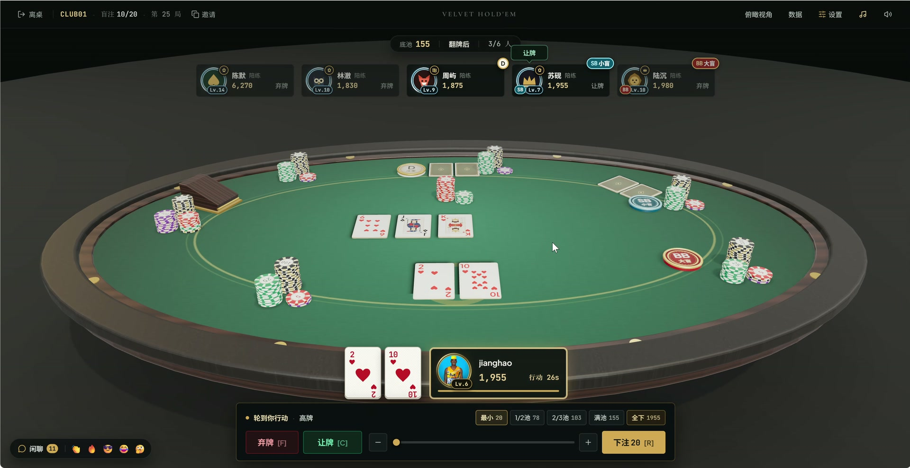
  <br />
  <sub>桌面端 3D 绿绒牌桌 · 移动端或无 WebGL 环境自动回退至 2D 牌桌</sub>
</p>

<br />

## 实机演示

<p align="center">
  <a href="docs/media/promo.mp4">
    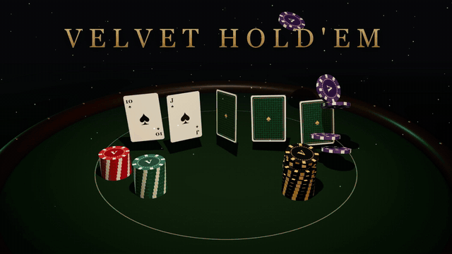
  </a>
  <br />
  <sub>
    点击画面播放 <a href="docs/media/promo.mp4"><strong>1 分钟完整宣传片（1080p · 含实录爵士 BGM 与物理筹码原声）</strong></a>
  </sub>
</p>

<br />

从进大厅入座、视角切换、全押摊牌到聊骚复盘，完整一局的交互节奏：

<table>
  <tr>
    <td width="50%" align="center">
      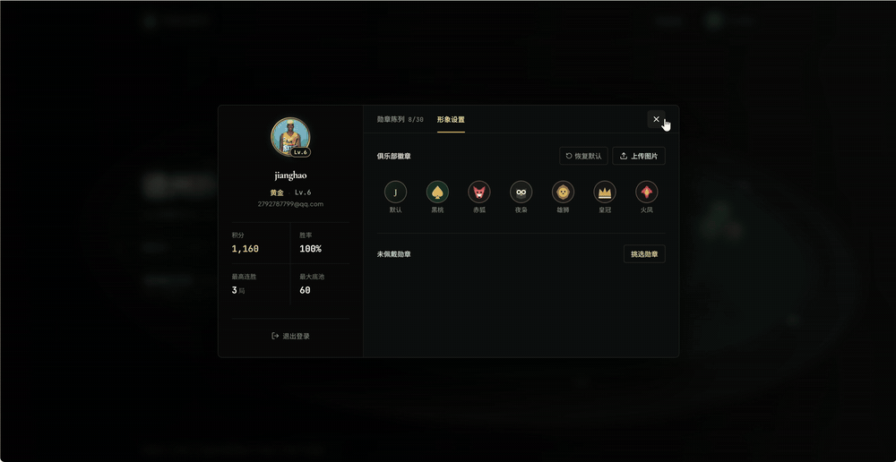
      <br />
      <strong>进厅入座</strong><br />
      <sub>3D 牌室大厅浏览房间，一键进入牌桌</sub>
    </td>
    <td width="50%" align="center">
      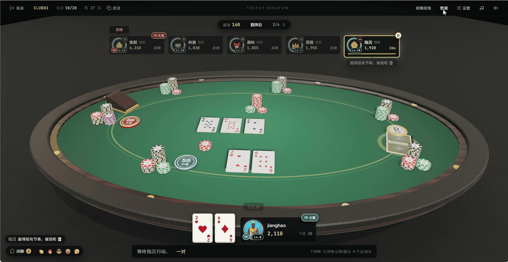
      <br />
      <strong>双视角切换</strong><br />
      <sub>经典 45° 视角与 90° 全局俯瞰平滑过渡</sub>
    </td>
  </tr>
  <tr>
    <td width="50%" align="center">
      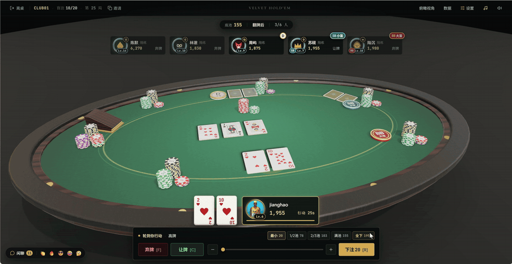
      <br />
      <strong>全押与赢池反馈</strong><br />
      <sub>Canvas 光刃冲击、筹码溅射与成就即时弹出</sub>
    </td>
    <td width="50%" align="center">
      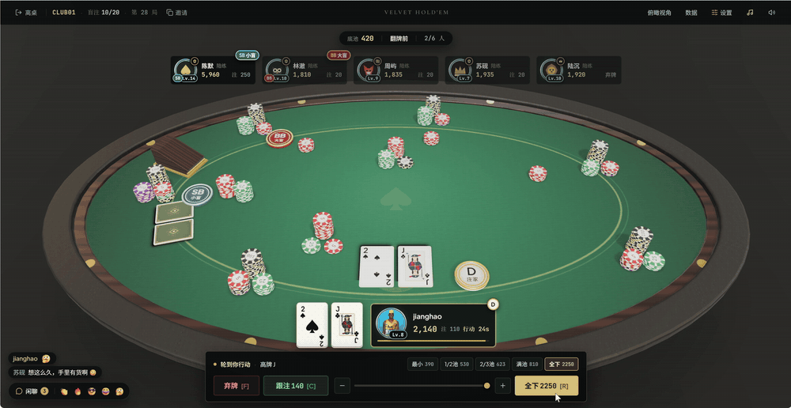
      <br />
      <strong>全下摊牌</strong><br />
      <sub>全员全下自动发完公共牌，多级边池精确结算</sub>
    </td>
  </tr>
  <tr>
    <td width="50%" align="center">
      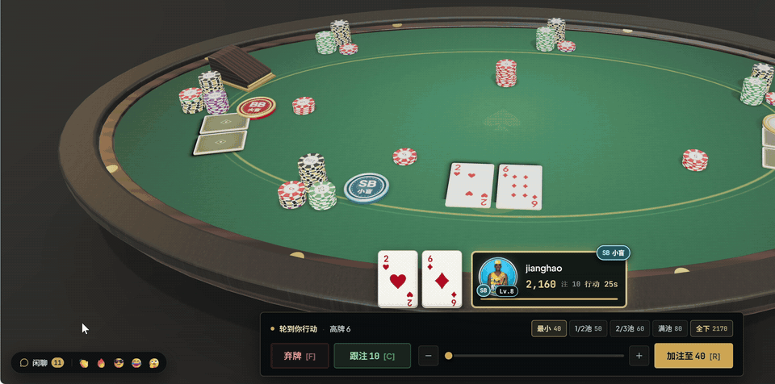
      <br />
      <strong>沙龙闲聊</strong><br />
      <sub>快捷短语与表情合一，AI 陪练会自然接话</sub>
    </td>
    <td width="50%" align="center">
      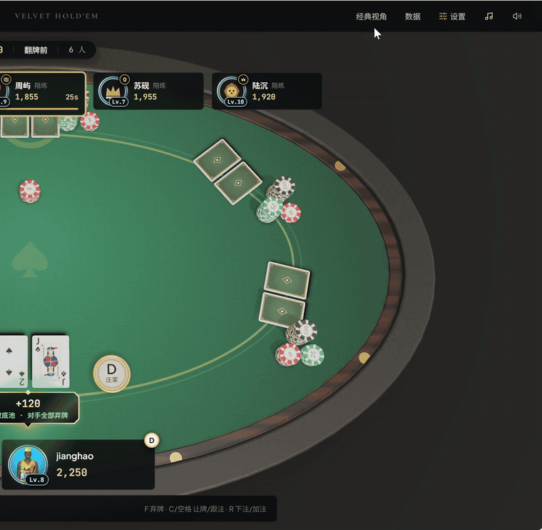
      <br />
      <strong>账簿与复盘</strong><br />
      <sub>排行、筹码曲线、分街底池、牌风与手牌回放</sub>
    </td>
  </tr>
</table>

<br />

## 牌局细节

### 牌桌质感与视觉克制

低饱和祖母绿绒面、胡桃木包边与黄铜饰钉由 Three.js 实时渲染，立体筹码按面值分色堆叠；纸牌采用高对比度配色与原创对称双头 `J / Q / K` 宫廷插画，`D / SB / BB` 指示物在经典与俯瞰视角下都清晰可辨。

<table>
  <tr>
    <td width="50%" align="center">
      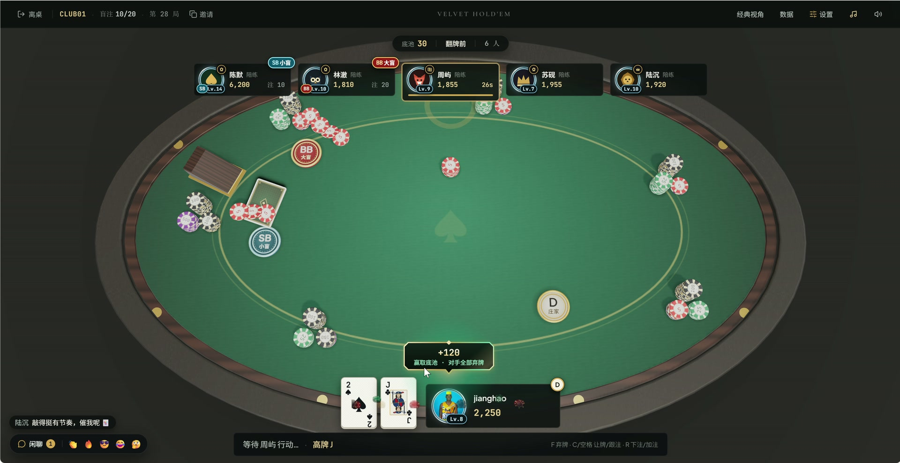
      <br />
      <sub>俯瞰全局视角 · 筹码柱与盲位指示物</sub>
    </td>
    <td width="50%" align="center">
      
      <br />
      <sub>原创双头宫廷牌面与内置牌型速查</sub>
    </td>
  </tr>
</table>

### 打击特效与物理声效

全押（All-in）与赢取底池时，头像上方触发基于 Canvas 2D 绘制的动态气泡——金红光刃、冲击波与多面额筹码喷泉，悬停头像则有细腻的粒子涟漪。每次下注按筹码面值（`5 / 25 / 100 / 500 / 1000+`）实时合成不同质感的碰撞音，配以轻爵士 BGM，按 `M` 可一键静音。

<table>
  <tr>
    <td width="50%" align="center">
      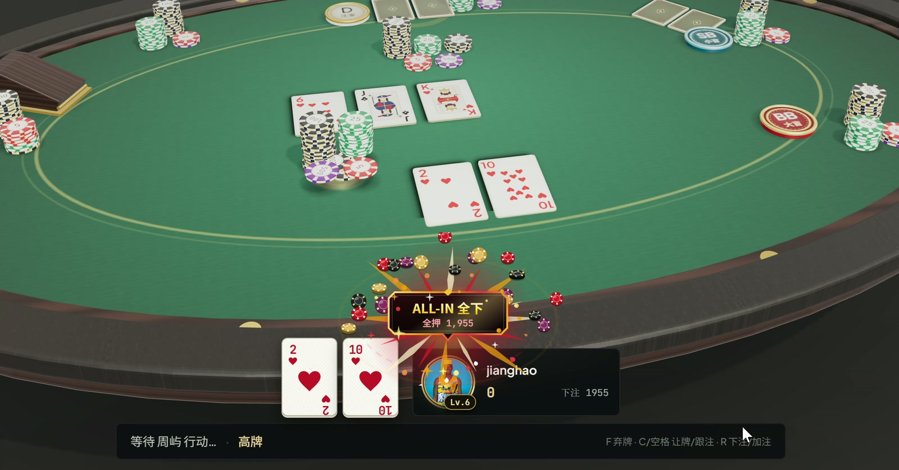
      <br />
      <sub>全押触发光刃、冲击波与筹码溅射</sub>
    </td>
    <td width="50%" align="center">
      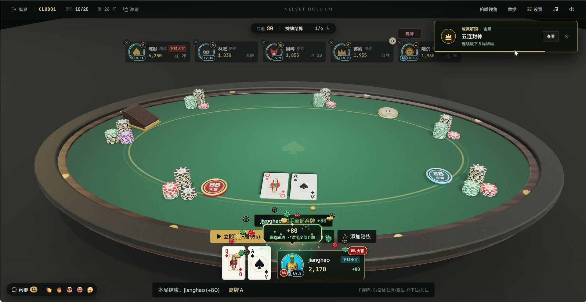
      <br />
      <sub>赢池飘字与右上角成就解锁通知</sub>
    </td>
  </tr>
</table>

### WSOP / TDA 清算与 GTO v2 陪练

规则引擎严格按 WSOP / TDA 标准实现：2–10 人桌、密码学安全洗牌（`crypto.randomInt`）、多人全下多级边池、超额未跟注退还、中途离桌死钱守恒、短全下不重开加注（Rule 47），以及局间补码与出局重买。

人不够时可随时增减策略型陪练。**GTO v2** 内置 6-max / HU 169 手牌翻前频率矩阵、≤15BB Nash 推/弃表、零分配 O(1) 7 张牌评估、蒙特卡洛范围胜率估算、最小防守频率（MDF）、阻断牌与几何下注尺度；也可以在「牌桌设置」中**非强制**填入 DeepSeek API，让陪练在摊牌和闲聊时自然接梗，或辅助局后 GTO 复盘点评。

<table>
  <tr>
    <td width="50%" align="center">
      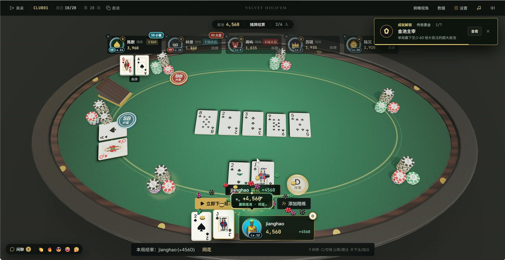
      <br />
      <sub>摊牌亮牌与随排行榜流转的段位光环</sub>
    </td>
    <td width="50%" align="center">
      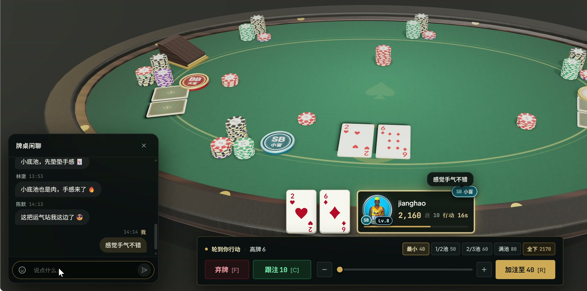
      <br />
      <sub>左下角极简闲聊抽屉 · 不遮挡核心牌面</sub>
    </td>
  </tr>
</table>

### 牌局账簿与复盘

点顶栏「数据」可展开右侧抽屉，从实时筹码排行、逐手走势、分街底池折线图、牌风画像（胜率 / VPIP / 摊牌胜率）到最近 20 手的逐街动作时间线，完整保留每一局的来龙去脉。

<p align="center">
  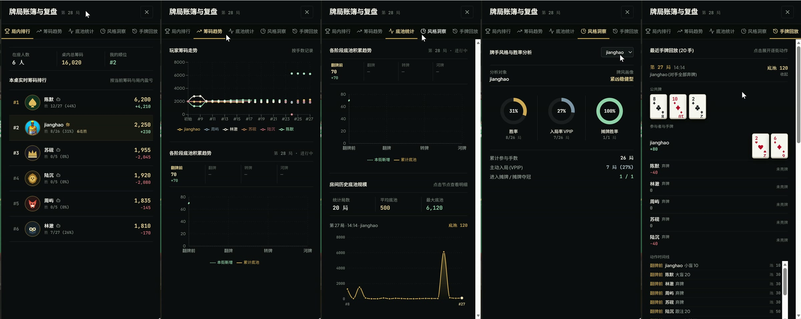
  <br />
  <sub>局内排行 · 玩家筹码走势 · 分街与历史底池 · 风格洞察 · 最近 20 手动作回放</sub>
</p>

### 个人中心、30 枚勋章与无门槛约局

打开大厅无需注册即可一键入桌或建房约局；若需要跨设备保存战绩，可通过右上角 **6 位邮箱验证码**登录同步个人中心（登录后自动合并游客阶段的本地成就）。

牌桌上单击任意头像可查看生涯数据与勋章陈列。勋章馆收录 **30 枚**成就，涵盖荣耀战绩、实战风格与「传奇 10-2」「7-2 传说」「天选倒霉蛋」「大滑头绝杀」「火箭坠毁」「空气赢家」等真实牌局趣事，分铜、银、金、传奇黑金四档；支持 7 款俱乐部徽章与自定义头像上传。

<table>
  <tr>
    <td width="50%" align="center">
      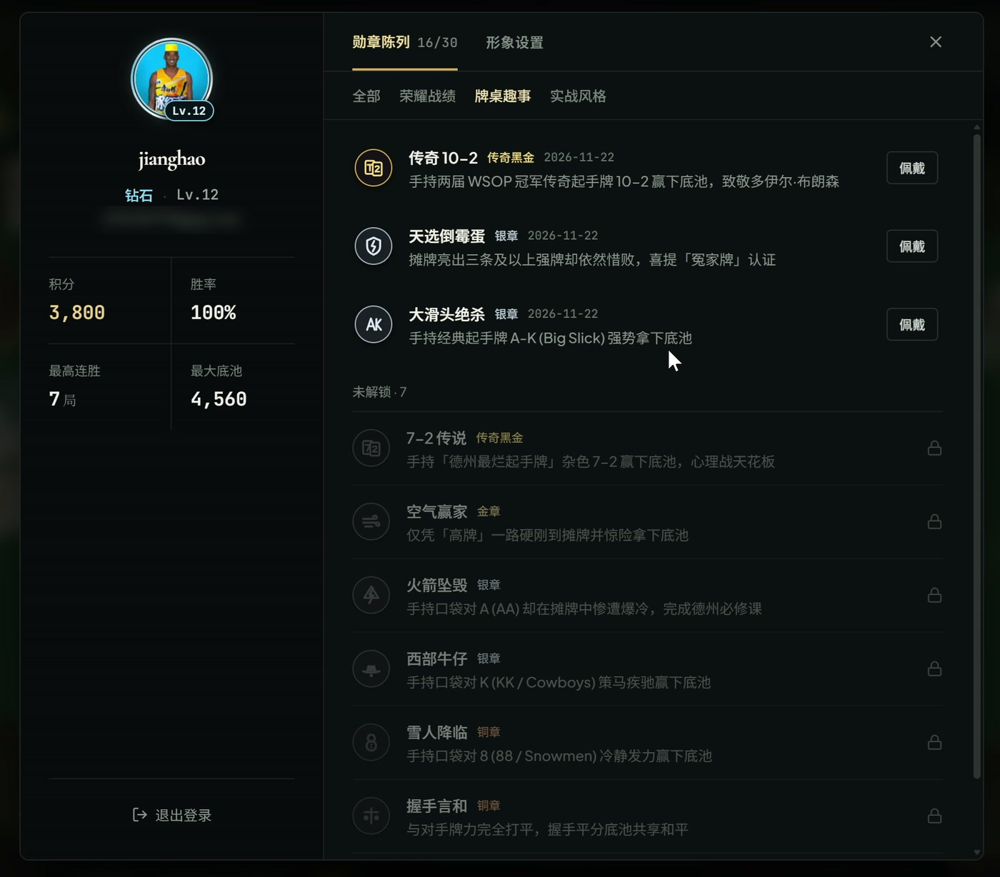
      <br />
      <sub>30 枚四档稀有度勋章 · 记录解锁时刻并可佩戴</sub>
    </td>
    <td width="50%" align="center">
      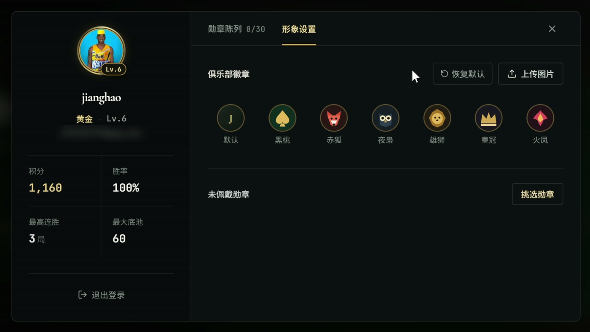
      <br />
      <sub>7 款俱乐部徽章与自定义头像上传</sub>
    </td>
  </tr>
</table>

<p align="center">
  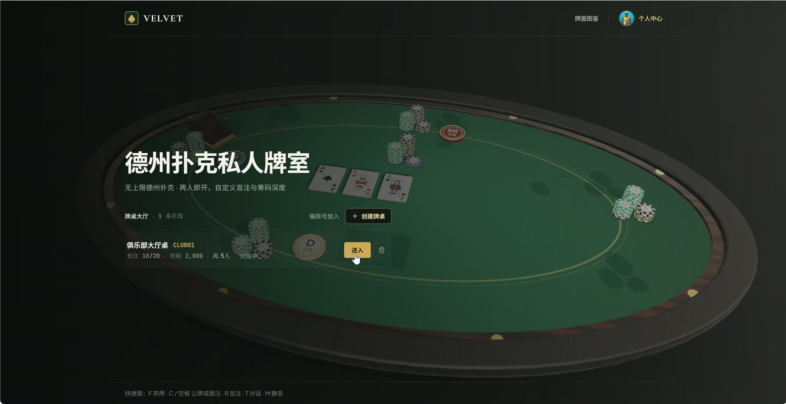
  <br />
  <sub>3D 牌室大厅 · 自定义盲注与筹码深度 · 房号邀约好友</sub>
</p>

<br />

## 架构与部署

| 层 | 实现 |
| :--- | :--- |
| 前端 | React 19 · TypeScript · Vite 8 · Tailwind CSS v4 · Three.js · Canvas 2D |
| 实时通信 | Express + `ws` 单端口同源承载 · 心跳回收僵尸连接 · 断线重连态锁定下注 |
| 持久化 | Node.js 22 原生 `node:sqlite`（WAL 模式），存储账号、排行榜与脱敏 `hand_history` |
| GTO 引擎 | `gtoRanges.ts`（169 翻前矩阵 / Nash）· `botAi.ts`（蒙特卡洛胜率）· `gtoCoach.ts` |
| 安全与鉴权 | 纯邮箱 6 位 OTP（冷却 + 试错锁定 + 限流）· HMAC 会话 Token · `X-Seat-Secret` 座位防冒充 |

<details>
<summary>目录结构</summary>

```text
.
├── server.ts                  # Express + WebSocket 主服务与房间生命周期
├── server/
│   ├── db.ts                  # Node 22 原生 SQLite (WAL) 初始化与 hand_history
│   ├── authStore.ts           # 邮箱 6 位 OTP 鉴权、SMTP/Resend 发信与会话吊销
│   ├── roomAuth.ts            # X-Seat-Secret 常量时间校验与房主删房鉴权
│   ├── leaderboard.ts         # 排行榜与陪练局归一化统计
│   ├── rateLimiter.ts         # 滑动窗口限流（HTTP / OTP / WebSocket）
│   ├── gtoRanges.ts           # 6-max / HU 169 手牌 GTO 矩阵与 Nash 推/弃表
│   ├── botAi.ts               # GTO v2 决策引擎、O(1) 7 张牌评估与蒙特卡洛胜率
│   ├── gtoCoach.ts            # GTO 局面评估与可选 DeepSeek 复盘点评
│   └── botChat.ts             # AI 陪练对话上下文与脱敏过滤
├── src/
│   ├── shared/                # 前后端共享德州核心规则引擎、牌力评估、成就与段位
│   ├── context/               # 邮箱登录会话与档案同步
│   ├── components/            # 大厅、3D/2D 牌桌、个人中心、数据抽屉
│   ├── three/                 # Three.js 牌桌、筹码物理与镜头过渡
│   └── utils/                 # 物理筹码合成音效、爵士 BGM 与 Canvas 特效
├── docs/media/                # 宣传片 (promo.mp4)、流程动图与实机截图
├── deploy/nginx.conf.example  # Nginx HTTPS + WSS 反向代理参考配置
├── Dockerfile                 # 多阶段构建（node:22-slim 非 root 镜像）
├── docker-compose.yml         # 一键编排与 ./data 持久化卷
└── UI_CONTRACT.md             # 前后端 REST / WebSocket 契约
```

</details>

### 快速启动

**Docker Compose（推荐）**

```bash
git clone https://github.com/jianghao-jianghao-jianghao/newHoldem.git
cd newHoldem
cp .env.example .env          # 留空也可直接以游客身份畅玩
docker compose up -d --build
```

**本地开发（需 Node.js >= 22.5）**

```bash
git clone https://github.com/jianghao-jianghao-jianghao/newHoldem.git
cd newHoldem
npm install
npm run dev
```

启动后访问 `http://localhost:3000`（服务健康探针：`GET /api/health`）。公网部署如需配置 HTTPS / WSS，可参考 [deploy/nginx.conf.example](deploy/nginx.conf.example) 并在 `.env` 中设置 `TRUST_PROXY=1` 与强随机 `AUTH_SESSION_SECRET`。

> Windows + WSL2 环境下使用 Docker 时，建议在 `C:\Users\<用户名>\.wslconfig` 的 `[wsl2]` 下设置 `vmIdleTimeout=-1`，防止 WSL2 休眠中断本地端口。

<details>
<summary>环境变量、校验命令与核心接口</summary>

<br />

复制 `.env.example` 为 `.env` 按需配置（全部均为可选项）：

| 环境变量 | 默认值 | 说明 |
| :--- | :--- | :--- |
| `PORT` | `3000` | 服务端口（同源承载前端、REST API 与 `/ws`） |
| `DATA_DIR` | `./data` | SQLite 数据库与密钥目录（Docker 内自动挂载至 `/app/data`） |
| `AUTH_SESSION_SECRET` | 自动生成 | 会话 Token HMAC 签名密钥（公网部署请设为 ≥32 位随机串） |
| `ALLOW_OTP_PREVIEW` | `false` | 仅本地无邮件服务调试时设为 `true`，生产保持 `false` |
| `SMTP_*` / `RESEND_API_KEY` | — | 邮箱验证码发信配置（Resend 优先级高于 SMTP） |
| `DEEPSEEK_API_KEY` / `DEEPSEEK_MODEL` | `deepseek-chat` | 可选服务端默认 DeepSeek 配置，用于 AI 陪练对话与 GTO 点评 |
| `TRUST_PROXY` / `CORS_ORIGIN` | `0` / `*` | 反向代理跳数（Nginx 后置设 `1`）与跨域白名单 |
| `VITE_SERVER_URL` | 留空 | 前后端分离部署时的后端地址 |

```bash
npm run lint    # TypeScript 类型检查
npm test        # 15 个测试套件，92 项单元测试
npm run build   # Vite 前端 + esbuild 后端生产构建
npm start       # 启动生产产物
```

| 接口 | 说明 |
| :--- | :--- |
| `GET /api/health` | 运行状态、在线桌数、持久化引擎与 `botEngine: "gto-v2"` 探针 |
| `GET / POST / DELETE /api/rooms` | 房间列表、创建私人牌桌、凭 `X-Player-Id` + `X-Seat-Secret` 删房 |
| `POST /api/auth/send-code` · `verify-code` | 邮箱 6 位 OTP 发送与登录（自动关联游客本地成就） |
| `GET / PATCH /api/auth/session` · `profile` · `logout` | 会话查询、资料更新与服务端吊销 |
| `POST /api/gto/evaluate` | GTO 局面分析（可选 `useLlm: true` 生成中文复盘点评） |
| `GET /api/hands` · `GET /api/hands/:id` | SQLite 历史手牌查询与脱敏回放 |
| `WS /ws` | 入座、下注、聊天、轻敲提醒、AI 陪练增减与实时广播 |

</details>

<br />

## 操作与快捷键

快捷键自动忽略 `Ctrl / Meta / Alt` 组合键，并在聊天输入或弹窗打开时暂停触发。

| 按键 / 手势 | 作用 |
| :--- | :--- |
| `F` | 弃牌（Fold） |
| `C` / `Space` | 让牌（Check）或跟注（Call） |
| `R` | 按当前滑块金额下注 / 加注（Raise） |
| `T` | 展开 / 收起牌桌闲聊 |
| `M` | 静音 / 恢复音效与爵士 BGM |
| `Esc` | 关闭当前弹窗或面板 |
| 单击任意头像 | 查看牌手档案、实时数据与勋章 |
| 双击对手头像 | 发送轻敲桌面提醒 |

<br />

## 合规说明

本项目仅用于软件工程学习与亲友间的免费休闲娱乐：

- **纯虚拟积分**：桌面显示的筹码、盲注、底池、盈亏与排行均为无任何货币价值的虚拟演练积分，不具备兑换或财产属性。
- **无资金通道**：不包含且不支持任何形式的充值、提现、抽水（Rake）或支付结算功能，严禁用于开设赌场、组织网络赌博或任何违反当地法律法规的活动。
- **责任自负**：代码按 MIT 协议以「现状（AS IS）」开源提供；任何第三方二次开发、公网部署或运营行为的合规义务及法律责任均由实际部署方自行承担。
- **密钥隐私**：DeepSeek 对话与邮箱验证码均为可选项；玩家在页面手动填入的密钥仅驻留于当前房间内存，不落盘、不回显，离桌或关闭房间即清除。

Released under the [MIT License](LICENSE).
