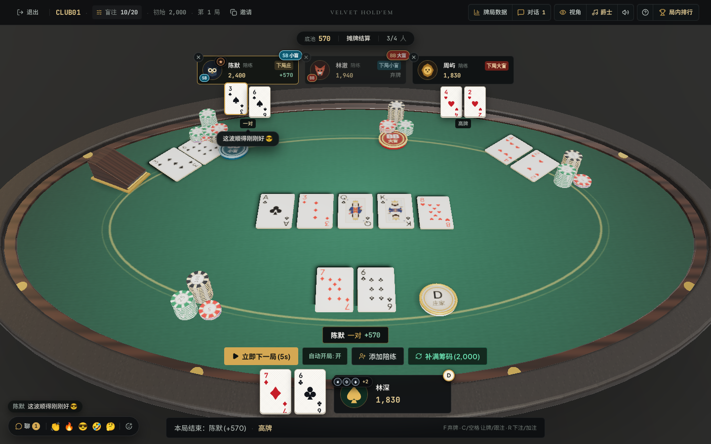
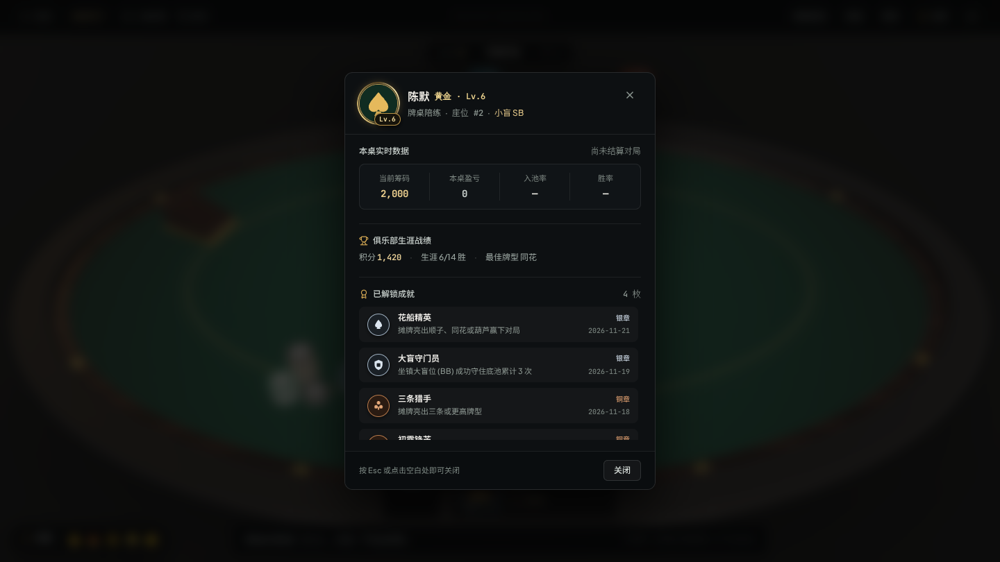

<p align="center">
  
</p>

<div align="center">

<h3>把私人德州俱乐部的克制质感，搬进浏览器</h3>

<p>
  3D 丝绒牌桌 · WSOP / TDA 严谨结算 · GTO v2 陪练引擎 · SQLite 持久化 · 邮箱验证码与游客免登录并行 · Docker 一键部署
</p>

<p>
  <a href="#实机演示">实机演示</a> &nbsp;·&nbsp;
  <a href="#核心亮点">核心亮点</a> &nbsp;·&nbsp;
  <a href="#技术架构与安全特性">架构特性</a> &nbsp;·&nbsp;
  <a href="#快捷键与手势">操作指南</a> &nbsp;·&nbsp;
  <a href="#快速部署">快速部署</a> &nbsp;·&nbsp;
  <a href="#免责与合规说明">合规说明</a>
</p>

<p>
  
  
  
  
  
  = 22.5" />
  
</p>

</div>

---

**Velvet Hold'em** 是一款面向亲友约局与个人 GTO 练牌打造的 3D 实时多人无上限德州扑克。没有花哨廉价的棋牌弹窗，也没有含糊其辞的简化规则——从高对比度原创宫廷牌面、全下与赢池时的 Canvas 动态打击特效、按面值合成的物理筹码声效，到内置 169 手牌矩阵与蒙特卡洛胜率估算的 **GTO v2 陪练引擎**、SQLite WAL 持久化与 Docker 生产化部署，每个细节都围绕「打开即入局，久玩不累眼」打磨。

## 实机演示

<table>
  <tr>
    <td width="50%" align="center">
      
      <br />
      <strong>3D 发牌、筹码落池与双视角切换</strong><br />
      <sub>翻牌入桌、筹码堆叠、经典与俯瞰视角一键平滑切换</sub>
    </td>
    <td width="50%" align="center">
      
      <br />
      <strong>头像档案 · 陪练互动 · 数据复盘</strong><br />
      <sub>单击查看 VPIP 与勋章，双击提醒对手，陪练即时回话，侧栏展开底池曲线</sub>
    </td>
  </tr>
</table>

<p align="center">
  
  <br />
  <sub>桌面端 3D 绿绒实景牌桌 · 移动端或无 WebGL 环境自动无缝回退 2D 牌桌</sub>
</p>

---

## 核心亮点

### 1. 私人俱乐部视觉与 Canvas 动态互动特效

低饱和祖母绿绒面搭配胡桃木包边与黄铜饰钉，高对比度纸牌加深边缘投影，点数、花色与 `D / SB / BB` 盲位指示物一目了然。玩家触发**全押（All-in）**或**赢取底池**时，头像正上方实时呈现基于 Canvas 的动态互动气泡——金红强力打击光刃、双层冲击波与多面额立体筹码溅射，悬停头像还可触发实时粒子涟漪。

<table>
  <tr>
    <td width="50%" align="center">
      
      <br />
      <strong>俯瞰全局视角</strong><br />
      <sub>立体筹码柱、SB/BB/D 盲位指示物与桌面底池一目了然</sub>
    </td>
    <td width="50%" align="center">
      
      <br />
      <strong>原创宫廷人像牌面图鉴</strong><br />
      <sub>对称双头 J / Q / K 宫廷插画与传统弄臣大小鬼，内置牌型大小速查</sub>
    </td>
  </tr>
</table>

---

### 2. WSOP / TDA 严谨清算与 GTO v2 陪练引擎

- **严谨德州规则核心**：支持 2–10 人桌、密码学安全洗牌（`crypto.randomInt`）、多人全下多级边池清算、超额未跟注退还、中途离桌死钱守恒、短全下不重开加注（WSOP Rule 47）、局间补码与出局重买。
- **GTO v2 陪练策略引擎**：内置 169 手牌 6-max / HU 翻前频率矩阵、≤15BB Nash 推/弃表、零分配 O(1) 7 张牌评估、蒙特卡洛范围加权胜率估算、最小防守频率（MDF）、河牌最优诈唬比、阻断牌（Blockers）与几何下注尺度，并提供多种风格陪练（含 `gto_pro` 平衡型大师）。
- **可选 DeepSeek 能力**：支持在环境变量或「牌桌设置」中**非强制**接入 DeepSeek API，驱动牌桌陪练自然对话接梗与 `POST /api/gto/evaluate` GTO 复盘点评。

<table>
  <tr>
    <td width="50%" align="center">
      
      <br />
      <strong>摊牌亮牌与动态段位光环</strong><br />
      <sub>头像外围随排行榜段位实时流转青铜、白银、黄金、钻石光环</sub>
    </td>
    <td width="50%" align="center">
      
      <br />
      <strong>极简沙龙闲聊 · 表情与短语合一</strong><br />
      <sub>左下角轻巧胶囊一键展开，精选牌桌表情与快捷短语合一，不遮挡牌面</sub>
    </td>
  </tr>
</table>

---

### 3. 分街底池曲线、24 枚荣誉/趣事成就与物理筹码声效

右侧数据抽屉以折线图追踪当前牌局从**翻牌前 → 翻牌 → 转牌 → 河牌**的底池变化及多玩家筹码走势；牌桌上**单击任意头像**即可翻看实时盈亏、VPIP、摊牌胜率与已解锁勋章。成就馆收录 **24 枚** 荣誉与牌桌趣事勋章（包括「7-2 传说」「火箭坠毁」「空气赢家」「残血反杀」「天选倒霉蛋」「交完学费」等真实牌局彩蛋），每次下注均触发按面值（5 / 25 / 100 / 500 / 1000+）建模的物理筹码声效。

<table>
  <tr>
    <td width="50%" align="center">
      
      <br />
      <strong>分街底池折线图与筹码走势</strong><br />
      <sub>实时记录各街底池增量、局内净胜榜、打法洞察与单手牌回放</sub>
    </td>
    <td width="50%" align="center">
      
      <br />
      <strong>单击头像档案与 24 枚趣味成就</strong><br />
      <sub>按荣耀战绩、牌桌趣事、实战风格分类浏览，记录每枚勋章解锁时刻</sub>
    </td>
  </tr>
</table>

---

### 4. 游客免登录直玩 × 纯邮箱验证码个人中心

- **零门槛入局**：无需注册或登录，打开大厅即可一键加入牌桌、自定义盲注/初始筹码创建私人房间，或输入房号与好友约局。
- **邮箱验证码账号体系**：点击右上角「登录」通过 6 位邮箱验证码（支持 SMTP / Resend 真实发信）验证身份后，即可解锁跨设备同步的个人中心——保存积分、净盈亏、胜率、连胜、等级头像与成就勋章；登录前以游客身份获得的本地成就也会自动合并入账号。

<p align="center">
  
  <br />
  <sub>牌室大厅 · 自动生成房号 · 自定义盲注与初始筹码深度 · 游客直玩与邮箱验证码登录并行</sub>
</p>

---

## 技术架构与安全特性

| 模块 | 实现细节 |
| :--- | :--- |
| **前端渲染** | React 19 + TypeScript + Vite 8 + Tailwind CSS v4 + Three.js 3D WebGL（移动端自动回退 2D 丝绒牌桌） |
| **实时通信** | Express + `ws` 同源单端口服务，客户端自动心跳检测、僵尸连接回收与断线重连态锁定下注 |
| **数据持久化** | Node.js 22 原生 `node:sqlite`（WAL 模式），持久化账号档案、排行榜与手牌回放（`hand_history`，自动脱敏未亮出的底牌），优雅停机自动执行 `WAL checkpoint` |
| **GTO 引擎** | `server/gtoRanges.ts`（169 手牌频率矩阵 + Nash 推/弃）+ `server/botAi.ts`（蒙特卡洛范围胜率 + 几何下注）+ `server/gtoCoach.ts`（局面复盘与可选 LLM 点评） |
| **鉴权与防作弊** | 纯邮箱 6 位 OTP 校验（60 秒冷却 + 5 次试错锁定 + 滑动窗口限流）、HMAC 签名会话 Token、登出服务端吊销、`X-Seat-Secret` 座位防冒充/防恶意删房、服务端权威战绩结算防伪造 |
| **前后端协同** | 维护 [UI_CONTRACT.md](UI_CONTRACT.md) 接口与事件契约，方便前端 UI 迭代与后端逻辑独立演进 |

<details>
<summary>目录结构速览</summary>

```text
.
├── server.ts                  # Express + WebSocket 主服务、房间生命周期与安全中间件
├── server/
│   ├── db.ts                  # Node 22 原生 SQLite (WAL) 初始化、迁移与 hand_history
│   ├── authStore.ts           # 邮箱 6 位 OTP 鉴权、SMTP/Resend 发信与会话管理
│   ├── roomAuth.ts            # X-Seat-Secret 常量时间校验与房主删房鉴权
│   ├── leaderboard.ts         # 排行榜与陪练局归一化统计持久化
│   ├── rateLimiter.ts         # 滑动窗口限流器（HTTP / OTP / WebSocket）
│   ├── gtoRanges.ts           # 6-max / HU 169 手牌 GTO 翻前矩阵与 Nash 推/弃表
│   ├── botAi.ts               # GTO v2 决策引擎、O(1) 7 张牌评估与蒙特卡洛胜率
│   ├── gtoCoach.ts            # GTO 局面评估与可选 DeepSeek 中文复盘点评
│   └── botChat.ts             # 牌桌 AI 陪练对话上下文与脱敏过滤
├── src/
│   ├── shared/                # 前后端共享德州核心规则引擎、牌力评估、成就与段位模型
│   ├── context/               # AuthContext（邮箱验证码会话与个人档案同步）
│   ├── components/            # 大厅、3D/2D 牌桌、个人中心、邮箱登录弹窗与数据抽屉
│   ├── three/                 # Three.js 丝绒牌桌、筹码与镜头动画
│   └── utils/                 # 物理筹码合成音效、爵士 BGM 与 Canvas 打击特效
├── deploy/
│   └── nginx.conf.example     # Nginx HTTPS + WebSocket 反向代理模板
├── Dockerfile                 # 多阶段构建（node:22-slim 非 root 生产镜像）
├── docker-compose.yml         # 一键编排与 /app/data 持久化卷配置
├── UI_CONTRACT.md             # 前后端 REST / WebSocket 协同契约
└── .env.example               # 环境变量模板
```

</details>

---

## 快捷键与手势

快捷键自动忽略 `Ctrl / Meta / Alt` 组合键，并在聊天输入或弹窗打开时暂停触发：

| 按键 / 手势 | 功能 |
| :--- | :--- |
| `F` | 弃牌（Fold） |
| `C` / `Space` | 让牌（Check）或跟注（Call） |
| `R` | 按当前滑块金额下注 / 加注（Raise） |
| `T` | 展开 / 收起牌桌闲聊 |
| `M` | 静音 / 恢复音效与爵士 BGM |
| `Esc` | 关闭当前弹窗或面板 |
| **单击任意头像** | 打开牌手档案，查看实时数据与成就勋章 |
| **双击对手头像** | 发送轻敲桌面提醒 |

---

## 快速部署

### 方式一：Docker Compose 一键部署（推荐）

内置多阶段 `node:22-slim` 非 root 镜像、健康检查（`/api/health`）与 `./data` SQLite 持久化挂载：

```bash
git clone https://github.com/jianghao-jianghao-jianghao/newHoldem.git
cd newHoldem

# 复制环境变量模板（按需填写 SMTP/Resend 与 DeepSeek 密钥；留空亦可直接游客畅玩）
cp .env.example .env

# 构建并后台启动
docker compose up -d --build

# 验证服务健康状态
curl http://localhost:3000/api/health
```

启动后访问 `http://localhost:3000`。如需绑定公网域名与 HTTPS / WSS，可参考 [deploy/nginx.conf.example](deploy/nginx.conf.example) 配置反向代理（记得在 `.env` 中设置 `TRUST_PROXY=1` 与强随机 `AUTH_SESSION_SECRET`）。

> **Windows + WSL2 提示**：若 Docker 运行在 WSL2 内，请保持至少一个 WSL 终端在线（或在 `C:\Users\<用户名>\.wslconfig` 的 `[wsl2]` 下配置 `vmIdleTimeout=-1`），避免 WSL2 自动休眠导致 `localhost:3000` 断开。

---

### 方式二：本地开发运行

环境要求：**Node.js >= 22.5.0**（使用原生 `node:sqlite`）：

```bash
git clone https://github.com/jianghao-jianghao-jianghao/newHoldem.git
cd newHoldem
npm install
npm run dev
```

启动后访问 `http://localhost:3000`。

<details>
<summary>环境变量参考、测试与构建命令</summary>

<br />

复制 `.env.example` 为 `.env` 按需配置（未配置邮件与 DeepSeek 时，游客游玩与本地 GTO 陪练均可完整运行）：

| 环境变量 | 默认值 | 说明 |
| :--- | :--- | :--- |
| `PORT` | `3000` | 服务监听端口（同源承载前端静态资源、REST API 与 `/ws`） |
| `DATA_DIR` | `./data` | SQLite 数据库与会话密钥存放目录（Docker 内自动挂载至 `/app/data`） |
| `AUTH_SESSION_SECRET` | 自动生成 | 登录 Token HMAC 签名密钥（生产环境建议设置 ≥32 位随机十六进制串） |
| `ALLOW_OTP_PREVIEW` | `false` | 仅限本地无邮件服务测试时设为 `true`，生产环境保持 `false` |
| `SMTP_HOST` / `SMTP_PORT` / `SMTP_USER` / `SMTP_PASS` / `SMTP_FROM` | — | SMTP 邮箱验证码发信配置（支持 QQ 邮箱 `smtp.qq.com:465` 等） |
| `RESEND_API_KEY` | — | 可选 Resend 邮件 API 密钥（优先级高于 SMTP） |
| `DEEPSEEK_API_KEY` / `DEEPSEEK_BASE_URL` / `DEEPSEEK_MODEL` | `deepseek-chat` | 可选服务端默认 DeepSeek 配置，用于 AI 陪练聊天与 GTO 复盘点评 |
| `TRUST_PROXY` / `CORS_ORIGIN` | `0` / `*` | 反向代理跳数（Nginx 后置请设 `1`）与允许的跨域来源 |
| `VITE_SERVER_URL` | 留空 | 前后端分离部署时的后端地址（同源部署留空即可） |

常用开发校验命令：

```bash
# TypeScript 类型检查
npm run lint

# 运行全部 15 个测试套件（92 项单元测试）
npm test

# 生产构建（Vite 前端 + esbuild 后端）
npm run build

# 启动生产产物
npm start
```

</details>

<details>
<summary>核心 HTTP 与 WebSocket 接口速览</summary>

| 接口 | 说明 |
| :--- | :--- |
| `GET /api/health` | 运行状态、在线桌数、内存占用、持久化引擎与 `botEngine: "gto-v2"` 探针 |
| `GET /api/rooms` · `POST /api/rooms` · `DELETE /api/rooms/:roomId` | 获取大厅房间列表、免登录创建私人牌桌、凭 `X-Player-Id` + `X-Seat-Secret` 删除自定义牌桌 |
| `POST /api/auth/send-code` · `POST /api/auth/verify-code` | 发送 6 位邮箱验证码与验证登录（自动关联游客本地成就） |
| `GET /api/auth/session` · `PATCH /api/auth/profile` · `POST /api/auth/logout` | 获取/更新个人资料、吊销当前登录会话 |
| `POST /api/gto/evaluate` | GTO 局面分析接口（支持可选 `useLlm: true` 生成 DeepSeek 中文复盘建议） |
| `GET /api/hands` · `GET /api/hands/:id` | 查询 SQLite 已记录的手牌历史与脱敏回放 |
| `WS /ws` | 牌桌入座、下注、聊天、轻敲提醒、AI 陪练增减与实时广播 |

</details>

---

## 免责与合规说明

本项目（Velvet Hold'em）仅用于软件工程学习与亲友间的免费休闲娱乐，请在使用或部署前了解以下边界：

- **纯虚拟积分**：桌面显示的筹码、盲注、底池、盈亏与排行均为无任何货币价值的虚拟演练积分，不具备兑换或财产属性。
- **无资金通道**：项目不包含且不支持任何形式的充值、提现、抽水（Rake）或支付结算功能，严禁用于开设赌场、组织网络赌博或任何违反当地法律法规的活动。
- **部署责任自负**：代码按 MIT 协议以「现状（AS IS）」开源提供；任何第三方二次开发、公网部署或运营行为的合规义务及相应法律责任，均由实际部署方自行承担。
- **外部接口密钥**：DeepSeek 对话与邮件验证码均为非强制可选功能；玩家在页面中手动填写的密钥仅驻留于当前房间运行内存，不落盘、不回显，离桌或关闭房间即清除。

## License

Released under the [MIT License](LICENSE).
