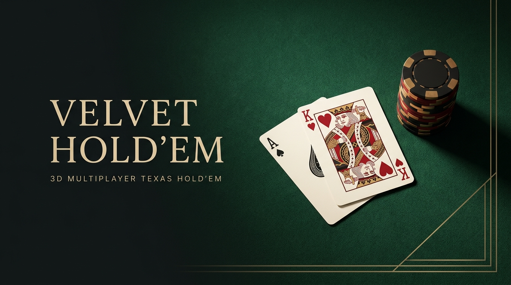
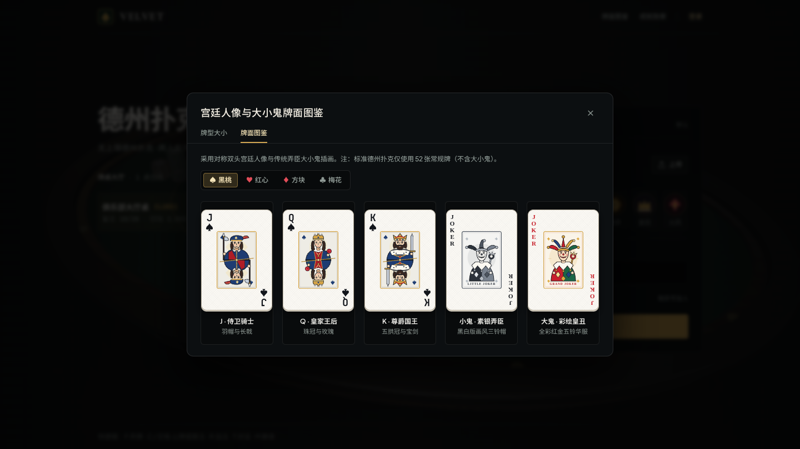

<p align="center">
  <a href="#宣传片">
    
  </a>
</p>

<div align="center">

<h3>把私人德州俱乐部的克制质感，搬进浏览器</h3>

<p>
  <a href="#宣传片">宣传片</a> &nbsp;&nbsp;·&nbsp;&nbsp;
  <a href="#一局流程">一局流程</a> &nbsp;&nbsp;·&nbsp;&nbsp;
  <a href="#设计与实现">设计与实现</a> &nbsp;&nbsp;·&nbsp;&nbsp;
  <a href="#系统架构">系统架构</a> &nbsp;&nbsp;·&nbsp;&nbsp;
  <a href="#快速启动">快速启动</a> &nbsp;&nbsp;·&nbsp;&nbsp;
  <a href="#合规说明">合规说明</a>
</p>

<p>
  
  
  
  
  
</p>

<br />

<p>
  为亲友约局与个人练牌打造的 3D 实时多人无上限德州扑克。<br />
  没有花哨廉价的棋牌弹窗，也没有含糊其辞的简化规则——围绕「<strong>打开即入局，久玩不累眼</strong>」打磨每一处交互。
</p>

</div>

<br />

## 宣传片

<p align="center">
  
  <br />
  <sub>
    完整 65 秒实机宣传片（真彩动态 WebP 主页直播） · 需要 1080p 含爵士 BGM 与物理筹码原声版请
    <a href="https://github.com/jianghao-jianghao-jianghao/newHoldem/raw/main/docs/media/promo.mp4"><strong>直接下载 / 播放原片（MP4）</strong></a>
  </sub>
</p>

<br />

<table>
  <tr>
    <td width="25%" valign="top">
      <strong>3D 丝绒美学</strong><br />
      <sub>Three.js 实景牌桌、胡桃木包边、立体筹码物理堆叠与双视角切换，无 WebGL 自动回退 2D。</sub>
    </td>
    <td width="25%" valign="top">
      <strong>严谨清算与 GTO v2</strong><br />
      <sub>WSOP / TDA 多级边池与 Rule 47，内置 169 手牌矩阵、Nash 推弃与蒙特卡洛胜率陪练。</sub>
    </td>
    <td width="25%" valign="top">
      <strong>物理声效与打击感</strong><br />
      <sub>全押光刃与筹码喷泉特效，按筹码面值实时合成物理碰撞音，配轻爵士 BGM 一键静音。</sub>
    </td>
    <td width="25%" valign="top">
      <strong>零门槛与持久化</strong><br />
      <sub>游客免登录直玩、6 位邮箱验证码跨端同步、原生 SQLite (WAL) 存储与 Docker 一键起服。</sub>
    </td>
  </tr>
</table>

<p align="center">
  
  <br />
  <sub>桌面端 3D 绿绒实景牌桌 · 移动端或无 WebGL 环境自动回退至 2D 牌桌</sub>
</p>

<p align="center"></p>

## 一局流程

从牌室入座、视角切换、全押摊牌到闲聊复盘，六段实录动图呈现完整一局的交互节奏：

<table>
  <tr>
    <td width="33.3%" align="center" valign="top">
      <br />
      <strong>01 · 进厅入座</strong><br />
      <sub>3D 牌室大厅浏览在线桌，一键入局</sub>
    </td>
    <td width="33.3%" align="center" valign="top">
      <br />
      <strong>02 · 双视角切换</strong><br />
      <sub>经典 45° 与 90° 全局俯瞰平滑过渡</sub>
    </td>
    <td width="33.3%" align="center" valign="top">
      <br />
      <strong>03 · 全押打击</strong><br />
      <sub>光刃冲击波、筹码溅射与成就解锁</sub>
    </td>
  </tr>
  <tr>
    <td width="33.3%" align="center" valign="top">
      <br />
      <strong>04 · 全下摊牌</strong><br />
      <sub>全员全下自动发牌，多级边池结算</sub>
    </td>
    <td width="33.3%" align="center" valign="top">
      <br />
      <strong>05 · 沙龙闲聊</strong><br />
      <sub>表情短语合一，AI 陪练自然接话</sub>
    </td>
    <td width="33.3%" align="center" valign="top">
      <br />
      <strong>06 · 账簿复盘</strong><br />
      <sub>排行、走势、底池、牌风与手牌回放</sub>
    </td>
  </tr>
</table>

<p align="center"></p>

## 设计与实现

<table>
  <tr>
    <td width="58%" align="center" valign="middle">
      
    </td>
    <td width="42%" valign="middle">
      <h4>克制牌桌质感 × Canvas 打击与物理声效</h4>
      <p>低饱和祖母绿绒面搭配胡桃木包边与黄铜饰钉，高对比度原创双头 <code>J / Q / K</code> 宫廷牌面与 <code>D / SB / BB</code> 指示物清晰耐看。</p>
      <p>全押与赢池时在头像上方触发 Canvas 2D 金红光刃、双层冲击波与立体筹码喷泉；每次下注按筹码面值（<code>5 / 25 / 100 / 500 / 1000+</code>）实时合成不同质感的物理碰撞音，按 <kbd>M</kbd> 同步控制音效与爵士 BGM。</p>
    </td>
  </tr>
  <tr>
    <td width="42%" valign="middle">
      <h4>WSOP / TDA 清算 × GTO v2 陪练引擎</h4>
      <p>完整支持 2–10 人桌、密码学安全洗牌（<code>crypto.randomInt</code>）、多人全下多级边池、超额未跟注退还、中途离桌死钱守恒、Rule 47 短全下规则，以及局间补码与出局重买。</p>
      <p>内置 <strong>GTO v2</strong> 策略陪练——覆盖 6-max / HU 169 手牌翻前矩阵、≤15BB Nash 推/弃表、零分配 O(1) 7 张牌评估、蒙特卡洛范围胜率、MDF、阻断牌与几何下注尺度；亦可在设置中<strong>非强制</strong>接入 DeepSeek API，驱动陪练闲聊接梗与局后复盘点评。</p>
    </td>
    <td width="58%" align="center" valign="middle">
      
    </td>
  </tr>
  <tr>
    <td width="58%" align="center" valign="middle">
      
    </td>
    <td width="42%" valign="middle">
      <h4>30 枚荣誉与趣事勋章 × 无门槛约局</h4>
      <p>打开大厅即可免登录建桌或凭房号入局；通过右上角 <strong>6 位邮箱验证码</strong>登录即可跨设备同步个人中心，自动合并游客期解锁的本地成就。</p>
      <p>勋章馆收录 <strong>30 枚</strong>铜 / 银 / 金 / 传奇黑金四档成就，囊括「传奇 10-2」「7-2 传说」「天选倒霉蛋」「大滑头绝杀」「火箭坠毁」「空气赢家」等经典牌局时刻；头像外圈随青铜至钻石段位实时流转光环。</p>
    </td>
  </tr>
</table>

<br />

<p align="center">
  
  <br />
  <sub>牌局账簿与复盘 · 局内排行 · 玩家筹码走势 · 分街与历史底池 · 牌风洞察（胜率 / VPIP / 摊牌胜率） · 最近 20 手逐街动作回放</sub>
</p>

<table>
  <tr>
    <td width="50%" align="center">
      <br />
      <sub>俯瞰全局视角 · 立体筹码柱与盲位指示物</sub>
    </td>
    <td width="50%" align="center">
      <br />
      <sub>原创双头宫廷人像与内置牌型速查图鉴</sub>
    </td>
  </tr>
  <tr>
    <td width="50%" align="center">
      <br />
      <sub>极简沙龙闲聊 · 表情与快捷短语合一</sub>
    </td>
    <td width="50%" align="center">
      <br />
      <sub>3D 牌室大厅 · 自定义盲注与房号邀约</sub>
    </td>
  </tr>
</table>

<details>
<summary>查看更多实机截图（赢池成就弹窗 · 俱乐部徽章与形象定制）</summary>

<br />

<table>
  <tr>
    <td width="50%" align="center">
      <br />
      <sub>赢池飘字与右上角成就解锁通知</sub>
    </td>
    <td width="50%" align="center">
      <br />
      <sub>7 款俱乐部徽章与自定义头像上传</sub>
    </td>
  </tr>
</table>

</details>

<p align="center"></p>

## 系统架构

<p align="center">
  <picture>
    <source media="(prefers-color-scheme: dark)" srcset="docs/media/architecture-dark.svg" />
    <source media="(prefers-color-scheme: light)" srcset="docs/media/architecture-light.svg" />
    
  </picture>
</p>

<details>
<summary>目录结构与前后端契约</summary>

```text
.
├── server.ts                  # Express + WebSocket 主服务、房间生命周期与安全中间件
├── server/
│   ├── db.ts                  # Node 22 原生 SQLite (WAL) 初始化与 hand_history
│   ├── authStore.ts           # 邮箱 6 位 OTP 鉴权、SMTP/Resend 发信与会话吊销
│   ├── roomAuth.ts            # X-Seat-Secret 常量时间校验与房主删房鉴权
│   ├── leaderboard.ts         # 排行榜与陪练局归一化统计
│   ├── rateLimiter.ts         # 滑动窗口限流（HTTP / OTP / WebSocket）
│   ├── gtoRanges.ts           # 6-max / HU 169 手牌 GTO 矩阵与 Nash 推/弃表
│   ├── botAi.ts               # GTO v2 决策引擎、O(1) 7 张牌评估与蒙特卡洛胜率
│   ├── gtoCoach.ts            # GTO 局面评估与可选 DeepSeek 复盘点评
│   └── botChat.ts             # AI 陪练对话上下文与脱敏过滤
├── src/
│   ├── shared/                # 前后端共享德州核心规则引擎、牌力评估、成就与段位
│   ├── context/               # 邮箱登录会话与档案同步
│   ├── components/            # 大厅、3D/2D 牌桌、个人中心、数据抽屉
│   ├── three/                 # Three.js 牌桌、筹码物理与镜头过渡
│   └── utils/                 # 物理筹码合成音效、爵士 BGM 与 Canvas 特效
├── docs/media/                # 宣传片 (promo.mp4)、流程动图与实机截图
├── deploy/nginx.conf.example  # Nginx HTTPS + WSS 反向代理参考配置
├── Dockerfile                 # 多阶段构建（node:22-slim 非 root 镜像）
├── docker-compose.yml         # 一键编排与 ./data 持久化卷
└── UI_CONTRACT.md             # 前后端 REST / WebSocket 协同契约
```

</details>

<p align="center"></p>

## 快速启动

<table>
  <tr>
    <td width="50%" valign="top">
      <strong>Docker Compose（推荐）</strong><br />
      <sub>内置 <code>node:22-slim</code> 非 root 镜像与 <code>./data</code> SQLite 持久化卷</sub>
      <pre lang="bash">git clone https://github.com/jianghao-jianghao-jianghao/newHoldem.git
cd newHoldem
cp .env.example .env
docker compose up -d --build</pre>
    </td>
    <td width="50%" valign="top">
      <strong>本地开发（Node.js &gt;= 22.5）</strong><br />
      <sub>零配置即可本地启动完整联机、SQLite 与 GTO v2 陪练</sub>
      <pre lang="bash">git clone https://github.com/jianghao-jianghao-jianghao/newHoldem.git
cd newHoldem
npm install
npm run dev</pre>
    </td>
  </tr>
</table>

启动后访问 `http://localhost:3000`（健康检查 `GET /api/health`）。公网 HTTPS / WSS 部署参考 [deploy/nginx.conf.example](deploy/nginx.conf.example)，生产环境请在 `.env` 中配置 `TRUST_PROXY=1` 与强随机 `AUTH_SESSION_SECRET`。

> Windows + WSL2 使用 Docker 时，建议在 `C:\Users\<用户名>\.wslconfig` 的 `[wsl2]` 下设置 `vmIdleTimeout=-1`，防止休眠中断本地端口。

<br />

**快捷键与手势**（聊天输入或弹窗打开时自动暂停，自动忽略组合键）：

<p>
  <kbd>F</kbd> 弃牌 &nbsp;·&nbsp;
  <kbd>C</kbd> / <kbd>Space</kbd> 让牌或跟注 &nbsp;·&nbsp;
  <kbd>R</kbd> 下注 / 加注 &nbsp;·&nbsp;
  <kbd>T</kbd> 闲聊 &nbsp;·&nbsp;
  <kbd>M</kbd> 静音音效与配乐 &nbsp;·&nbsp;
  <kbd>Esc</kbd> 关闭面板 &nbsp;·&nbsp;
  <strong>单击头像</strong> 查看档案与勋章 &nbsp;·&nbsp;
  <strong>双击对手</strong> 轻敲提醒
</p>

<details>
<summary>环境变量参考、测试命令与核心接口</summary>

<br />

复制 `.env.example` 为 `.env` 按需配置（全部为可选项）：

| 环境变量 | 默认值 | 说明 |
| :--- | :--- | :--- |
| `PORT` | `3000` | 服务端口（同源承载前端静态资源、REST API 与 `/ws`） |
| `DATA_DIR` | `./data` | SQLite 数据库与会话密钥目录（Docker 内自动挂载至 `/app/data`） |
| `AUTH_SESSION_SECRET` | 自动生成 | 会话 Token HMAC 签名密钥（公网部署建议设为 ≥32 位随机串） |
| `ALLOW_OTP_PREVIEW` | `false` | 仅本地无邮件服务调试时设为 `true`，生产保持 `false` |
| `SMTP_*` / `RESEND_API_KEY` | — | 邮箱验证码发信配置（Resend 优先级高于 SMTP） |
| `DEEPSEEK_API_KEY` / `DEEPSEEK_MODEL` | `deepseek-chat` | 可选服务端默认 DeepSeek 配置，用于 AI 陪练对话与 GTO 点评 |
| `TRUST_PROXY` / `CORS_ORIGIN` | `0` / `*` | 反向代理跳数（Nginx 后置设 `1`）与跨域白名单 |
| `VITE_SERVER_URL` | 留空 | 前后端分离部署时的后端地址 |

```bash
npm run lint    # TypeScript 类型检查
npm test        # 15 个测试套件，92 项单元测试
npm run build   # Vite 前端 + esbuild 后端生产构建
npm start       # 启动生产产物
```

| 接口 | 说明 |
| :--- | :--- |
| `GET /api/health` | 运行状态、在线桌数、持久化引擎与 `botEngine: "gto-v2"` 探针 |
| `GET / POST / DELETE /api/rooms` | 房间列表、创建私人牌桌、凭 `X-Player-Id` + `X-Seat-Secret` 删房 |
| `POST /api/auth/send-code` · `verify-code` | 邮箱 6 位 OTP 发送与登录（自动关联游客本地成就） |
| `GET / PATCH /api/auth/session` · `profile` · `logout` | 会话查询、资料更新与服务端吊销 |
| `POST /api/gto/evaluate` | GTO 局面分析（可选 `useLlm: true` 生成中文复盘点评） |
| `GET /api/hands` · `GET /api/hands/:id` | SQLite 历史手牌查询与脱敏回放 |
| `WS /ws` | 入座、下注、聊天、轻敲提醒、AI 陪练增减与实时广播 |

</details>

<p align="center"></p>

## 合规说明

本项目仅用于软件工程学习与亲友间的免费休闲娱乐：

- **纯虚拟积分**：桌面显示的筹码、盲注、底池、盈亏与排行均为无任何货币价值的虚拟演练积分，不具备兑换或财产属性。
- **无资金通道**：不包含且不支持任何形式的充值、提现、抽水（Rake）或支付结算功能，严禁用于开设赌场、组织网络赌博或任何违反当地法律法规的活动。
- **责任自负**：代码按 MIT 协议以「现状（AS IS）」开源提供；任何第三方二次开发、公网部署或运营行为的合规义务及法律责任均由实际部署方自行承担。
- **密钥隐私**：DeepSeek 对话与邮箱验证码均为可选项；玩家在页面手动填入的密钥仅驻留于当前房间内存，不落盘、不回显，离桌或关闭房间即清除。

<br />

<div align="center">
  <sub>Released under the <a href="LICENSE">MIT License</a> · Velvet Hold'em</sub>
</div>
