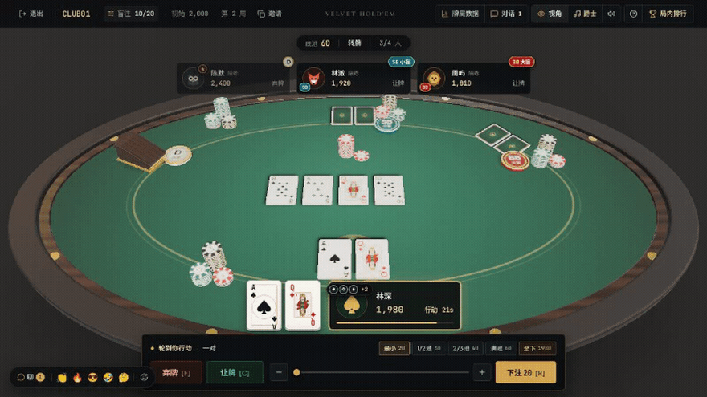

<div align="center">

<br />

# VELVET HOLD'EM

**把私人德州俱乐部的克制质感，搬进浏览器**

<sub>3D 丝绒牌桌 · WSOP / TDA 严谨结算 · 物理筹码声效 · 分街底池曲线 · 可选 DeepSeek 陪练对话</sub>

<br />

<p>
  
  
  
  
  
</p>

<p>
  <a href="#动态实机演示">实机演示</a> ·
  <a href="#核心亮点">核心亮点</a> ·
  <a href="#体验优势">体验优势</a> ·
  <a href="#快捷键与手势">操作指南</a> ·
  <a href="#快速运行">快速运行</a> ·
  <a href="#法律与合规声明">法律声明</a>
</p>

<br />


<br />
<br />

</div>

**Velvet Hold'em** 是一款为亲友约局与个人练牌打造的 3D 实时多人无上限德州扑克。没有花哨廉价的棋牌弹窗，没有含糊其辞的玩具规则——从高对比度定制宫廷牌面、按面值建模的物理筹码碰撞声，到多人全下边池清算与会接梗的 AI 陪练，所有细节都围绕「打开即入局，久玩不累眼」打磨。

> **免责提示**：本项目仅用于技术学习与亲友免费休闲娱乐，所有筹码与排行均为**无任何货币价值的虚拟积分**，不含充值、提现或现金交易功能。详见文末 [法律与合规声明](#法律与合规声明)。

---

## 动态实机演示

<table>
  <tr>
    <td width="50%" align="center">
      
      <br />
      <strong>3D 发牌、筹码落池与双视角切换</strong><br />
      <sub>翻牌入桌、筹码堆叠、经典与俯瞰视角一键平滑切换</sub>
    </td>
    <td width="50%" align="center">
      
      <br />
      <strong>头像档案 · 双击轻敲 · 陪练接梗 · 数据复盘</strong><br />
      <sub>单击查 VPIP 与勋章，双击提醒对手，陪练即时回话，侧栏展开底池曲线</sub>
    </td>
  </tr>
</table>

---

## 核心亮点

### 1. 私人俱乐部视觉：3D 绿绒牌桌与定制宫廷牌面

低饱和祖母绿绒面搭配实木包边与黄铜饰钉，高对比度纸牌加深边缘投影，在深色环境下点数、花色与 `D / SB / BB` 盲位筹码一眼清晰；桌面端支持「经典 / 俯瞰」双视角切换，移动端或无 WebGL 环境自动无缝回退至 2D 牌桌。

<table>
  <tr>
    <td width="50%" align="center">
      
      <br />
      <strong>俯瞰全局视角</strong><br />
      <sub>立体筹码柱、SB/BB/D 盲位指示物与桌面底池一目了然</sub>
    </td>
    <td width="50%" align="center">
      
      <br />
      <strong>原创宫廷人像牌面图鉴</strong><br />
      <sub>对称双头 J / Q / K 宫廷插画与传统弄臣大小鬼，内置牌型大小速查</sub>
    </td>
  </tr>
</table>

---

### 2. 严谨规则与有性格的 AI 陪练（可选 DeepSeek 对话）

内置符合 WSOP / TDA 标准的德州结算核心，支持 2–10 人大桌、多人全下多级边池清算、中途离桌死钱守恒、短全下不重开加注（Rule 47）以及局间补码与出局重买。人不够时一键邀请策略型 AI 陪练开局；还可在聊天栏**非强制**开启 DeepSeek 对话，让陪练在摊牌、被催促或闲聊时自然接话发表情。

<table>
  <tr>
    <td width="50%" align="center">
      
      <br />
      <strong>摊牌亮牌与陪练即时反应</strong><br />
      <sub>自动亮出成牌与赢池筹码，支持自动开局与局间一键补满筹码</sub>
    </td>
    <td width="50%" align="center">
      
      <br />
      <strong>轻量沙龙聊天 · 可选 DeepSeek 接入</strong><br />
      <sub>不填 Key 完全不影响牌局；密钥仅存本桌内存，绝不泄露任何未摊牌底牌</sub>
    </td>
  </tr>
</table>

---

### 3. 实时牌局账簿、玩家档案与物理听感

不用翻日志也能复盘每一手牌：右侧数据抽屉以折线图追踪当前牌局从**翻牌前 → 翻牌 → 转牌 → 河牌**的底池积累变化及多玩家筹码走势；牌桌上**单击任意头像**即可翻看实时数据与成就勋章；每次跟注、加注、All-in 均触发按筹码面值实时合成的物理碰撞声效，配合爵士酒吧环境配乐，临场感拉满。

<table>
  <tr>
    <td width="50%" align="center">
      
      <br />
      <strong>分街底池折线图与筹码走势</strong><br />
      <sub>实时记录各街底池增量、局内净胜榜、打法风格洞察与单手牌回放</sub>
    </td>
    <td width="50%" align="center">
      
      <br />
      <strong>单击头像档案与荣誉勋章</strong><br />
      <sub>实时呈现本桌盈亏、VPIP、摊牌胜率、生涯最佳牌型与已解锁勋章</sub>
    </td>
  </tr>
</table>

<p align="center">
  
  <br />
  <strong>牌室大厅与自由开桌</strong><br />
  <sub>自定义盲注结构与初始筹码深度 · 选择俱乐部徽章或上传头像 · 支持可选邮箱验证码登录</sub>
</p>

---

## 体验优势

| 亮点 | 实际带来的体验提升 |
| :--- | :--- |
| **物理筹码声效 + 爵士 BGM** | 基于筹码面值（5 / 25 / 100 / 500 / 1000+）合成不同厚重感的碰撞音，小跟注清脆、重注与 All-in 沉稳厚实，一键静音同步控管音效与配乐。 |
| **两人即开，随时凑桌** | 既支持发邀请链接与好友联机，也支持随时增减多风格 AI 陪练，不再因凑不齐人干等；输光筹码无需退房，局中亦可随时重买续战。 |
| **克制不遮挡的桌面排版** | 顶栏、底池状态条、座位气泡、操作坞与聊天抽屉严格分层避让；折叠态聊天仅占左下角一条轻巧表情胶囊，视线始终聚焦牌面。 |
| **按真赛标准算每一枚筹码** | 密码学真随机洗牌、多级边池、超额未跟注筹码退还、死钱守恒、WSOP Rule 47 全部经 65 条自动化单元测试验证，不错账、不卡局。 |
| **联机防冒充与断线守护** | 座位凭证校验杜绝顶号与恶意删房；双向心跳自动清理僵尸连接；网络波动重连期间自动锁定下注按钮防误操作，重连后无损恢复成就与座位。 |
| **零配置启动，隐私克制** | 无需任何 API Key 即可体验完整联机与陪练；DeepSeek 陪练聊天完全可选，手动填入的密钥仅驻留本桌运行内存，不落盘、不回显，离桌删房即清。 |

---

## 快捷键与手势

所有快捷键均自动忽略 `Ctrl / Meta / Alt` 系统组合键，聊天打字或弹窗打开时自动暂停，杜绝误操作：

| 按键 / 手势 | 功能 |
| :--- | :--- |
| `F` | 弃牌（Fold） |
| `C` / `Space` | 让牌（Check）或跟注（Call） |
| `R` | 按当前滑块金额下注 / 加注（Raise） |
| `T` | 展开 / 收起牌桌闲聊 |
| `M` | 静音 / 恢复音效与爵士 BGM |
| `Esc` | 关闭当前弹窗或面板 |
| **单击任意玩家头像** | 查看实时牌桌统计、生涯战绩与已解锁成就勋章 |
| **双击对手头像** | 发送「轻敲桌面」行动提醒 |

---

## 快速运行

需要 **Node.js >= 20**，零配置即可本地跑起完整联机与 AI 陪练牌局：

```bash
git clone https://github.com/<your-username>/velvet-holdem.git
cd velvet-holdem
npm install
npm run dev
```

浏览器打开 `http://localhost:3000` 即可入座。

<sub>技术栈：React 19 · TypeScript · Three.js · Tailwind CSS v4 · Recharts · Web Audio API · Express · WebSocket</sub>

<details>
<summary><strong>展开查看：可选环境变量与测试命令</strong></summary>

<br />

如需配置服务端默认 DeepSeek 密钥或真实邮件验证码发信，复制 `.env.example` 为 `.env` 按需填写（全部均为可选项）：

| 环境变量 | 用途 |
| :--- | :--- |
| `DEEPSEEK_API_KEY` / `DEEPSEEK_MODEL` | 服务端默认 DeepSeek 陪练对话配置（留空时玩家仍可在聊天设置内临时填写房间密钥） |
| `AUTH_SESSION_SECRET` | 邮箱验证码登录会话签名密钥（公网部署建议设置高强度随机串） |
| `RESEND_API_KEY` / `SMTP_*` | 邮箱 6 位验证码发信通道（未配置时自动以本地开发预览码模式运行） |
| `VITE_SERVER_URL` | 前后端分离部署时的后端服务地址（同源部署留空） |

```bash
# 类型检查
npm run lint

# 运行 65 条德州引擎、3D 模型、AI、声效与鉴权单元测试
npx tsx --test src/shared/*.test.ts src/utils/*.test.ts src/three/*.test.ts server/*.test.ts

# 生产构建
npm run build
```

</details>

---

## 法律与合规声明

> [!CAUTION]
> **请在使用、二次开发、部署或分发本项目前仔细阅读以下声明。继续使用本项目即视为您已充分理解并同意全部条款。**

1. **纯技术学习与免费休闲娱乐定位**
   本项目（Velvet Hold'em）是一款开源软件工程作品，仅用于展示 WebGL 3D 渲染、WebSocket 实时同步、博弈规则引擎、Web Audio 物理音效合成及 AI 交互技术，以及亲友间的**免费、非营利性智力休闲娱乐**。

2. **严禁赌博与任何形式的真钱交易（No Real-Money Gambling）**
   - 本项目中出现的「筹码」「盲注」「底池」「补码」「盈亏」「排行榜」均**仅为无任何财产价值的虚拟演练积分**。
   - 本项目**不包含、不支持、亦永不提供**任何法定货币、虚拟货币、礼品卡或实物资产的充值、兑换、回购、提现、抽水（Rake）或支付结算通道。
   - 严禁任何个人或组织利用本项目源码、衍生版本或部署实例从事开设赌场、组织网络赌博、聚众赌博、抽头渔利、资金清算或其他违反《中华人民共和国刑法》《中华人民共和国治安管理处罚法》及使用者所在地法律法规的活动。

3. **部署者与二次开发责任自负**
   本项目依据开源协议按「现状（AS IS）」提供。任何第三方对本项目进行的修改、二次开发、商业化运营或公网部署行为，均由实际部署者与使用者自行承担全部合规义务及由此引发的民事、行政与刑事法律责任；原作者及贡献者不承担任何连带责任。

4. **第三方服务与密钥安全**
   DeepSeek API 与邮件发信（Resend / SMTP）均为完全可选的外部集成，启用前请遵守对应服务商的使用条款。玩家在界面中手动填写的 DeepSeek API Key 仅暂存于当前房间的服务端内存中（不落盘、不回显，清除或删房即释放）；在公共演示环境中建议仅使用具备独立额度上限的临时密钥。

5. **健康娱乐与未成年人保护**
   请合理安排时间，适度健康娱乐，坚决抵制一切形式的赌博行为。未满所在司法辖区法定成年年龄的用户，请在监护人知情与指导下接触本项目。

---

## License

MIT License. 部署或二次开发前请务必同时遵守上述 [法律与合规声明](#法律与合规声明)。
