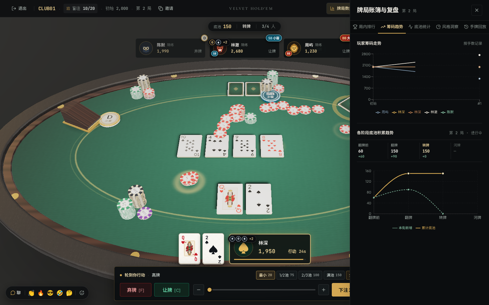

<div align="center">

<br />

# VELVET HOLD'EM

**暗金丝绒俱乐部风格的 3D 实时多人无上限德州扑克**

<sub>Three.js 3D 牌桌 · WSOP / TDA 规则引擎 · 物理筹码声效 · 实时数据复盘 · 可选 DeepSeek 陪练对话</sub>

<br />

<p>
  
  
  
  
  
</p>

<p>
  <a href="#界面预览">界面预览</a> ·
  <a href="#核心实现">核心实现</a> ·
  <a href="#本地运行">本地运行</a> ·
  <a href="#快捷键与手势">操作指南</a> ·
  <a href="#法律与合规声明">法律声明</a>
</p>

<br />


<br />
<br />

</div>

**Velvet Hold'em** 是一个围绕「私人俱乐部质感」与「严谨德州规则」构建的全栈多人扑克项目。前端以 Three.js 绘制低饱和暗金绿绒 3D 牌桌（移动端与无 WebGL 环境自动回退至 2D 牌桌），后端采用 Express 与 WebSocket 驱动纯函数结算引擎，支持 2–10 人实时联机、策略 AI 陪练凑桌、Web Audio 物理筹码声效以及实时牌局复盘。

> **合规提示**：本项目仅用于前后端实时通信、WebGL 图形渲染、博弈算法与 AI 交互技术研究及亲友免费休闲娱乐。系统内所有「筹码」「底池」「排行」均为**无货币价值的虚拟积分**，不含任何充值、提现或现金结算能力。使用或部署前请阅读文末 [法律与合规声明](#法律与合规声明)。

---

## 界面预览

<table>
  <tr>
    <td width="50%" align="center">
      
      <br />
      <strong>牌室大厅与入座登记</strong><br />
      <sub>自定义房间盲注与筹码深度，支持徽章选择、自定义头像上传与邮箱验证码登录</sub>
    </td>
    <td width="50%" align="center">
      
      <br />
      <strong>牌局账簿与分街底池趋势</strong><br />
      <sub>Recharts 绘制翻牌前至河牌的底池积累曲线、玩家筹码走势与单手牌回放</sub>
    </td>
  </tr>
  <tr>
    <td width="50%" align="center">
      
      <br />
      <strong>单击头像档案与成就勋章</strong><br />
      <sub>实时查看本桌盈亏、VPIP、摊牌胜率、生涯最佳牌型与已解锁勋章</sub>
    </td>
    <td width="50%" align="center">
      
      <br />
      <strong>沙龙聊天与可选 DeepSeek 陪练</strong><br />
      <sub>悬浮表情胶囊与磨砂抽屉；可选填入 DeepSeek Key 让陪练在牌桌自然搭话</sub>
    </td>
  </tr>
</table>

---

## 核心实现

### 牌桌视觉与听觉
- **3D 丝绒场景与 2D 自适应**：程序化生成绿绒台面、实木包边、高对比度定制人头牌面与深边缘投影；筹码柱随筹码量与面值动态构建，`D / SB / BB` 盲位在 3D 桌面与座位卡同步呈现。桌面端支持「经典 / 俯瞰」双视角切换，切后台自动暂停渲染，无 WebGL 时无缝回退 2D 牌桌。
- **物理筹码声效与环境配乐**：基于 Web Audio API 按筹码面值（`5 / 25 / 100 / 500 / 1000+`）实时合成碰撞音色，跟注、加注与 All-in 依据下注额呈现不同厚重感与级联节奏；内置程序化爵士环境音乐并与静音开关联动。
- **克制的交互层次**：顶部状态栏、对手座位气泡、操作坞与展开态聊天抽屉严格错位排布，避免信息遮挡。单击任意头像打开个人档案，双击对手头像轻敲桌面提醒。

### 德州规则引擎（WSOP / TDA）
- **真随机与筹码守恒**：使用 Node.js `crypto.randomInt` 执行 Fisher-Yates 洗牌；引擎严格处理主池与多级边池（Side Pots）、未跟注超额筹码退还、中途离桌死钱守恒（`deadContributions`）及余数筹码顺时针分配。
- **细节规则覆盖**：完整实现 WSOP Rule 47（不完整短全下不重开已行动玩家的加注权）、翻后首注（Bet）与加注（Raise）区分、全下逐街自动亮牌、自定义盲注与固定盲位、局间 Top-Up 补码以及出局后随时重买。

### 策略陪练与可选 DeepSeek 对话
- **多风格 AI 陪练**：结合起手牌强度、翻后成牌、听牌潜力（同花 / 两头顺 / 卡顺）、位置优势与底池赔率进行决策，支持随时一键增减陪练开局。
- **非强制 DeepSeek 接入**：聊天抽屉内提供独立的「陪练对话」开关与可选 API Key 输入（不填不影响任何牌局功能）。开启后陪练会在闲聊、被提醒或摊牌时搭话与发表情。
  - **公平与隐私边界**：传给模型的上下文仅含公开桌面信息，**绝不包含任何未摊牌底牌**；房间级密钥仅驻留服务端内存，不落盘、不回显，清除或删房后即刻销毁。

### 联机安全与复盘分析
- **防冒充与防误删**：入座签发独立 `seatSecret`，牌桌行动、陪练配置及房间删除均通过 `X-Player-Id` + `X-Seat-Secret` 核验。
- **稳定连接机制**：服务端与客户端双向 `ping/pong` 心跳自动清理僵尸连接；断线重连期间下注区自动禁用防误触，恢复后自动同步座位与已解锁成就；WebSocket 限制 64KB 载荷并对畸形消息做隔离处理。
- **局内复盘抽屉**：集成 Recharts 分街底池折线图、多玩家筹码轨迹图、局内净胜榜、手牌回放与风格统计。

---

## 目录结构

```text
.
├── server.ts                        # Express + WebSocket 服务入口（房间管理、鉴权、心跳与广播）
├── server/
│   ├── botAi.ts                     # AI 陪练决策引擎
│   ├── botChat.ts                   # 可选 DeepSeek 陪练对话代理与上下文脱敏
│   ├── authStore.ts                 # 邮箱 6 位 OTP 登录与 HMAC 会话签名
│   └── leaderboard.ts               # 全局战绩与积分榜管理
├── src/
│   ├── App.tsx                      # WebSocket 状态机、心跳保活与大厅/牌桌切换
│   ├── components/
│   │   ├── PokerTable.tsx           # 牌桌主界面、顶栏工具组与热键管理
│   │   ├── PokerScene3D.tsx         # Three.js 3D 牌桌、筹码堆与发牌动画
│   │   ├── SeatNode.tsx             # 座位卡（单击档案 / 双击提醒 / 盲位标识）
│   │   ├── ActionDock.tsx           # 标准底池比例加注坞（±1BB 微调与断线保护）
│   │   ├── TableChatPanel.tsx       # 悬浮快捷表情栏、聊天抽屉与 DeepSeek 设置
│   │   ├── PlayerProfileModal.tsx   # 玩家实时数据、生涯战绩与成就弹窗
│   │   └── TableAnalyticsDrawer.tsx # Recharts 分街底池曲线、筹码走势与手牌复盘
│   ├── three/                       # 程序化材质、3D 模型与筹码物理排布
│   ├── shared/                      # 前后端共享纯函数（手牌评估、牌局规则、趋势统计、成就）
│   └── utils/                       # Web Audio 物理筹码音效库与爵士 BGM 合成器
└── .env.example                     # 可选环境变量模板
```

---

## 本地运行

环境要求：**Node.js >= 20**。项目默认零配置即可运行全部联机与 AI 陪练功能。

```bash
git clone https://github.com/<your-username>/velvet-holdem.git
cd velvet-holdem
npm install
npm run dev
```

启动后访问 `http://localhost:3000`（同一端口承载前端页面与 WebSocket 牌桌服务）。

### 检查与测试

```bash
# TypeScript 静态类型检查
npm run lint

# 运行德州引擎、3D 模型、AI 策略、陪练对话、声效与鉴权单测（65 用例）
npx tsx --test src/shared/*.test.ts src/utils/*.test.ts src/three/*.test.ts server/*.test.ts

# 生产构建
npm run build
```

### 可选环境变量

如需启用服务端默认 DeepSeek 密钥或真实邮件发送，复制 `.env.example` 为 `.env` 按需配置：

| 变量 | 说明 |
| :--- | :--- |
| `DEEPSEEK_API_KEY` | 服务端默认 DeepSeek 密钥；留空时玩家仍可在聊天面板填入本桌内存密钥 |
| `DEEPSEEK_MODEL` | 对话模型名，默认 `deepseek-chat` |
| `AUTH_SESSION_SECRET` | 邮箱验证码登录会话的 HMAC 签名密钥（公网部署建议显式配置） |
| `RESEND_API_KEY` / `SMTP_*` | 邮箱 OTP 发信通道；未配置时自动以本地开发预览码运行 |
| `VITE_SERVER_URL` | 前后端分离部署时的后端地址；同源部署留空即可 |

---

## 快捷键与手势

所有快捷键均自动忽略 `Ctrl / Meta / Alt` 组合键，并在打开聊天输入框或模态弹窗时自动暂停：

| 按键 / 手势 | 操作 |
| :--- | :--- |
| `F` | 弃牌（Fold） |
| `C` / `Space` | 让牌（Check）或跟注（Call） |
| `R` | 按当前滑块金额下注 / 加注（Raise） |
| `T` | 展开 / 收起牌桌聊天抽屉 |
| `M` | 静音 / 恢复音效与背景音乐 |
| `Esc` | 关闭当前弹窗或聊天面板 |
| **单击任意玩家头像** | 查看该玩家的实时牌桌统计、生涯战绩与成就勋章 |
| **双击对手头像** | 向该对手发送「轻敲桌面」提醒 |

---

## 法律与合规声明

> [!CAUTION]
> **请在使用、二次开发、部署或分发本项目前仔细阅读以下条款。继续使用本项目即视为您已充分理解并同意受其约束。**

1. **技术研究与非营利休闲定位**
   本项目（Velvet Hold'em）为开源软件工程作品，仅用于展示 WebGL 3D 渲染、WebSocket 实时状态同步、德州扑克规则建模、Web Audio 音频合成及大语言模型交互等技术实现，以及亲友间的**免费、非营利性智力休闲娱乐**。

2. **严禁赌博与任何形式的真钱交易**
   - 本项目中的「筹码」「盲注」「底池」「补码」「盈亏」「积分榜」均仅为**无任何财产价值的虚拟演练数值**。
   - 本项目**不包含、不支持、亦永不提供**任何法定货币、虚拟货币、礼品卡或实物资产的充值、兑换、回购、提现、抽水（Rake）或支付结算功能。
   - 严禁任何个人或组织将本项目源码、衍生作品或部署实例用于开设赌场、组织网络赌博、聚众赌博、抽头渔利、资金结算或其他违反《中华人民共和国刑法》《中华人民共和国治安管理处罚法》及使用者所在地法律法规的行为。

3. **部署与二次开发责任自负**
   本项目依据开源协议按「现状（AS IS）」提供。任何第三方基于本项目进行的私自修改、二次开发、商业运营或公网部署行为，均由实际部署者与使用者自行承担全部合规审查义务及相应的民事、行政与刑事法律责任；原作者及贡献者对此不承担任何连带责任。

4. **第三方服务与密钥安全**
   DeepSeek API 与邮件发信（Resend / SMTP）均为完全可选的外部扩展，启用前请遵守对应服务商的使用条款。前端手动填写的 DeepSeek API Key 仅暂存于对应房间的服务端内存中（不写入磁盘、不在接口中回传，清除或删房即释放）；在公共演示环境中建议仅使用设置了独立额度上限的临时密钥。

5. **适度娱乐与未成年人保护**
   请理性控制娱乐时间，抵制一切形式的赌博行为。未满所在司法辖区法定成年年龄的用户，请在监护人知情与指导下接触本项目。

---

## License

MIT License. See the [法律与合规声明](#法律与合规声明) above before deploying or modifying this repository.
