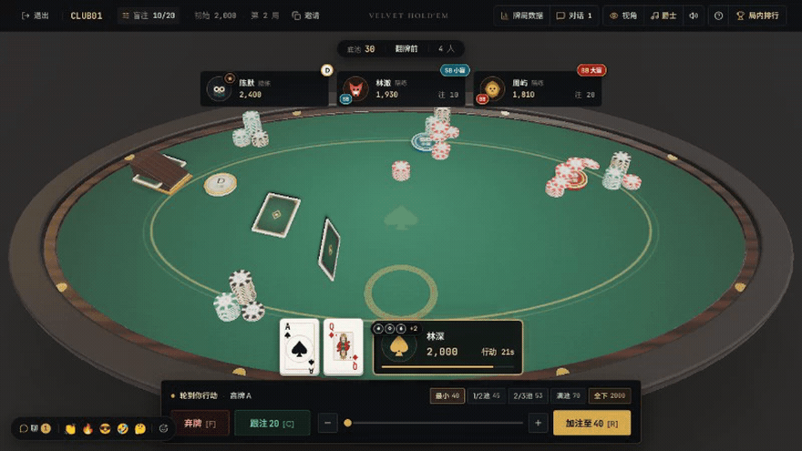
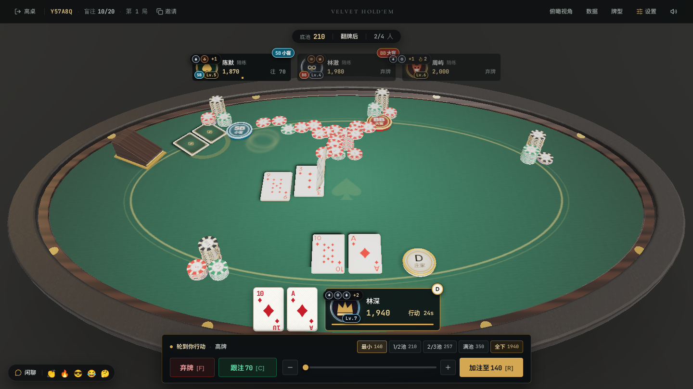
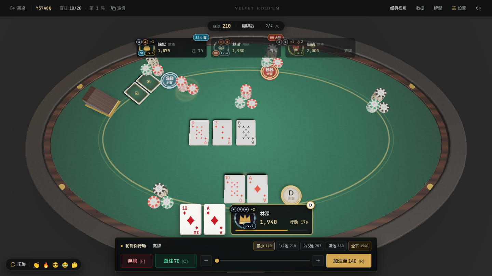
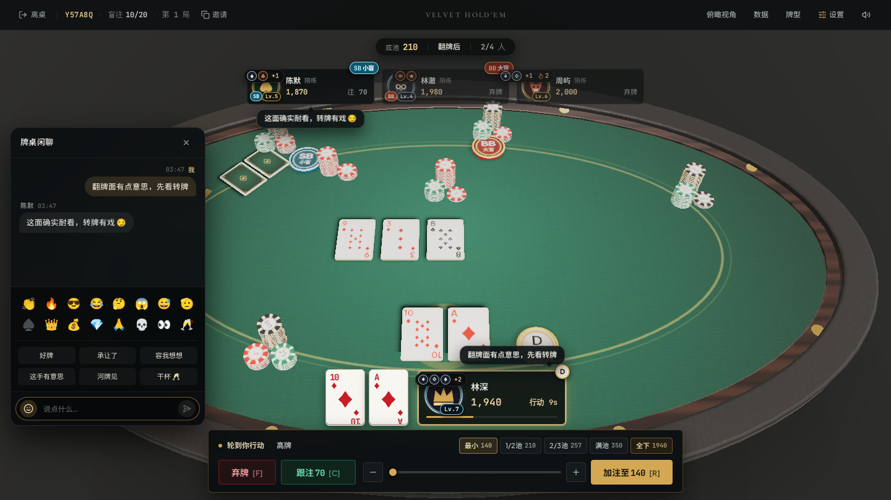
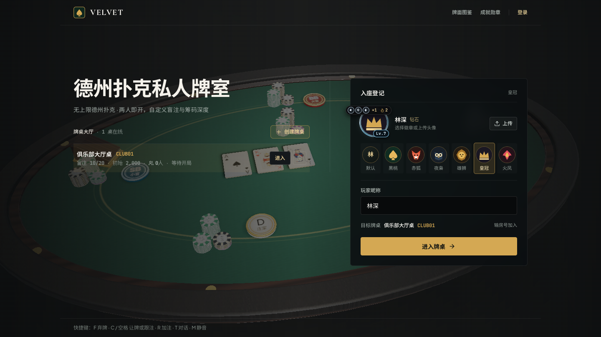

<p align="center">
  
</p>

<div align="center">

<h3>把私人德州俱乐部的克制质感，搬进浏览器</h3>

<p>
  3D 丝绒牌桌 · WSOP / TDA 严谨结算 · Canvas 动态打击特效 · 物理筹码声效 · 24 枚荣誉与趣事成就
</p>

<p>
  <a href="#实机演示">实机演示</a> &nbsp;·&nbsp;
  <a href="#核心亮点">核心亮点</a> &nbsp;·&nbsp;
  <a href="#体验优势">体验优势</a> &nbsp;·&nbsp;
  <a href="#快捷键与手势">操作指南</a> &nbsp;·&nbsp;
  <a href="#快速运行">快速运行</a> &nbsp;·&nbsp;
  <a href="#免责与合规说明">合规说明</a>
</p>

<p>
  
  
  
</p>

</div>

---

**Velvet Hold'em** 是一款为亲友约局与个人练牌打造的 3D 实时多人无上限德州扑克。没有花哨廉价的棋牌弹窗，也没有含糊其辞的简化规则——从高对比度原创宫廷牌面、全下与赢池时的 Canvas 动态打击与筹码溅射特效，到按面值实时合成的物理筹码声效与多人全下边池清算，每个细节都围绕「打开即入局，久玩不累眼」打磨。

## 实机演示

<table>
  <tr>
    <td width="50%" align="center">
      
      <br />
      <strong>3D 发牌、筹码落池与双视角切换</strong><br />
      <sub>翻牌入桌、筹码堆叠、经典与俯瞰视角一键平滑切换</sub>
    </td>
    <td width="50%" align="center">
      
      <br />
      <strong>头像档案 · 陪练互动 · 数据复盘</strong><br />
      <sub>单击查看 VPIP 与勋章，双击提醒对手，陪练即时回话，侧栏展开底池曲线</sub>
    </td>
  </tr>
</table>

<p align="center">
  
  <br />
  <sub>桌面端 3D 绿绒实景牌桌 · 移动端或无 WebGL 环境自动无缝回退 2D 牌桌</sub>
</p>

---

## 核心亮点

### 1. 私人俱乐部视觉与 Canvas 动态互动特效

低饱和祖母绿绒面搭配胡桃木包边与黄铜饰钉，高对比度纸牌加深边缘投影，点数、花色与 `D / SB / BB` 盲位指示物一目了然。玩家触发**全押（All-in）**或**赢取底池**时，头像正上方实时呈现基于 Canvas 的动态互动气泡——金红强力打击光刃、双层冲击波与多面额立体筹码溅射，悬停头像还可触发实时粒子涟漪。

<table>
  <tr>
    <td width="50%" align="center">
      
      <br />
      <strong>俯瞰全局视角</strong><br />
      <sub>立体筹码柱、SB/BB/D 盲位指示物与桌面底池一目了然</sub>
    </td>
    <td width="50%" align="center">
      
      <br />
      <strong>原创宫廷人像牌面图鉴</strong><br />
      <sub>对称双头 J / Q / K 宫廷插画与传统弄臣大小鬼，内置牌型大小速查</sub>
    </td>
  </tr>
</table>

---

### 2. 严谨规则、策略陪练与动态段位光环

内置符合 WSOP / TDA 标准的德州结算核心，支持 2–10 人桌、多人全下多级边池清算、中途离桌死钱守恒、短全下不重开加注（Rule 47）以及局间补码与出局重买。人不够时可随时增减策略型 AI 陪练，亦可在「牌桌设置」中**非强制**接入 DeepSeek API，让陪练在摊牌或闲聊时自然接梗。

<table>
  <tr>
    <td width="50%" align="center">
      
      <br />
      <strong>摊牌亮牌与动态段位光环</strong><br />
      <sub>头像外围随排行榜段位实时流转青铜、白银、黄金、钻石光环</sub>
    </td>
    <td width="50%" align="center">
      
      <br />
      <strong>极简沙龙闲聊 · 表情与短语合一</strong><br />
      <sub>左下角轻巧胶囊一键展开，精选牌桌表情与快捷短语合一，不遮挡牌面</sub>
    </td>
  </tr>
</table>

---

### 3. 分街底池曲线、24 枚荣誉/趣事成就与物理筹码声效

右侧数据抽屉以折线图追踪当前牌局从**翻牌前 → 翻牌 → 转牌 → 河牌**的底池变化及多玩家筹码走势；牌桌上**单击任意头像**即可翻看实时盈亏、VPIP、摊牌胜率与已解锁勋章。成就馆收录 **24 枚** 荣誉与牌桌趣事勋章（包括「7-2 传说」「火箭坠毁」「空气赢家」「残血反杀」「天选倒霉蛋」「交完学费」等真实牌局彩蛋），每次下注均触发按面值建模的物理筹码声效。

<table>
  <tr>
    <td width="50%" align="center">
      
      <br />
      <strong>分街底池折线图与筹码走势</strong><br />
      <sub>实时记录各街底池增量、局内净胜榜、打法洞察与单手牌回放</sub>
    </td>
    <td width="50%" align="center">
      
      <br />
      <strong>单击头像档案与 24 枚趣味成就</strong><br />
      <sub>按荣耀战绩、牌桌趣事、实战风格分类浏览，记录每枚勋章解锁时刻</sub>
    </td>
  </tr>
</table>

<p align="center">
  
  <br />
  <sub>牌室大厅 · 自动生成房号 · 自定义盲注与初始筹码深度 · 支持可选邮箱登录</sub>
</p>

---

## 体验优势

| 维度 | 具体实现 |
| :--- | :--- |
| **Canvas 打击与筹码溅射** | 全押触发强力打击光刃与微震回弹，赢取底池绽放多面额立体筹码喷泉，悬停头像可实时互动。 |
| **24 枚真实触发的成就体系** | 覆盖连胜、边池、大盲守门员、杂色 7-2 赢池、AA 爆冷、高牌摊牌胜、残血逆袭等德州经典桥段。 |
| **动态段位光环与头像同步** | 头像外围根据排行榜段位（青铜 / 白银 / 黄金 / 钻石）实时变幻光效，同步展示等级与勋章。 |
| **物理筹码声效 + 爵士 BGM** | 按筹码面值（5 / 25 / 100 / 500 / 1000+）合成不同质感的碰撞音，一键静音同步控管音效与配乐。 |
| **WSOP / TDA 严谨清算** | 密码学随机洗牌、多级边池、超额未跟注退还、死钱守恒、Rule 47 经 81 项自动化测试校验。 |
| **联机鉴权与断线保护** | 座位凭证防冒充与防恶意删房、心跳清理僵尸连接、重连态锁定下注防误点并无损恢复成就与座位。 |

---

## 快捷键与手势

快捷键自动忽略 `Ctrl / Meta / Alt` 组合键，并在聊天输入或弹窗打开时暂停触发：

| 按键 / 手势 | 功能 |
| :--- | :--- |
| `F` | 弃牌（Fold） |
| `C` / `Space` | 让牌（Check）或跟注（Call） |
| `R` | 按当前滑块金额下注 / 加注（Raise） |
| `T` | 展开 / 收起牌桌闲聊 |
| `M` | 静音 / 恢复音效与爵士 BGM |
| `Esc` | 关闭当前弹窗或面板 |
| **单击任意头像** | 打开牌手档案，查看实时数据与成就勋章 |
| **双击对手头像** | 发送轻敲桌面提醒 |

---

## 快速运行

环境要求：**Node.js >= 20**，零配置即可本地启动完整联机与 AI 陪练：

```bash
git clone https://github.com/<your-username>/velvet-holdem.git
cd velvet-holdem
npm install
npm run dev
```

启动后访问 `http://localhost:3000`。

<details>
<summary>可选环境变量与常用校验命令</summary>

<br />

如需启用服务端默认 DeepSeek 密钥或真实邮件发信，可复制 `.env.example` 为 `.env` 按需配置（全部均为可选项）：

| 环境变量 | 说明 |
| :--- | :--- |
| `DEEPSEEK_API_KEY` / `DEEPSEEK_MODEL` | 服务端默认 DeepSeek 陪练配置（不配置时也可在牌桌设置中临时填入） |
| `AUTH_SESSION_SECRET` | 邮箱登录会话签名密钥（公网部署建议替换为随机长串） |
| `RESEND_API_KEY` / `SMTP_*` | 邮箱验证码发信服务（留空时自动使用本地开发预览码） |
| `VITE_SERVER_URL` | 前后端分离部署时的服务端地址（同源部署留空） |

```bash
# 类型检查
npm run lint

# 运行全部 81 项单元测试
npx tsx --test src/shared/*.test.ts src/utils/*.test.ts src/three/*.test.ts server/*.test.ts

# 生产构建
npm run build
```

</details>

---

## 免责与合规说明

本项目（Velvet Hold'em）仅用于软件工程学习与亲友间的免费休闲娱乐，请在使用或部署前了解以下边界：

- **纯虚拟积分**：桌面显示的筹码、盲注、底池、盈亏与排行均为无任何货币价值的虚拟演练积分，不具备兑换或财产属性。
- **无资金通道**：项目不包含且不支持任何形式的充值、提现、抽水（Rake）或支付结算功能，严禁用于开设赌场、组织网络赌博或任何违反当地法律法规的活动。
- **部署责任自负**：代码按 MIT 协议以「现状（AS IS）」开源提供；任何第三方二次开发、公网部署或运营行为的合规义务及相应法律责任，均由实际部署方自行承担。
- **外部接口密钥**：DeepSeek 对话与邮件验证码均为非强制可选功能；玩家在页面中手动填写的密钥仅驻留于当前房间运行内存，不落盘、不回显，离桌或关闭房间即清除。

## License

Released under the [MIT License](LICENSE).
